# 🎬 110 styles d'animation + leurs prompts

**Le cadeau de [Skyfall Lab.IA](https://www.instagram.com/skyfalllab.ia/)** : 110 styles d'animation, chacun avec
**3 prompts prêts à copier** (image, animation, animation en code). Ils marchent avec **ton personnage et ta scène** :
il suffit de remplacer les crochets.

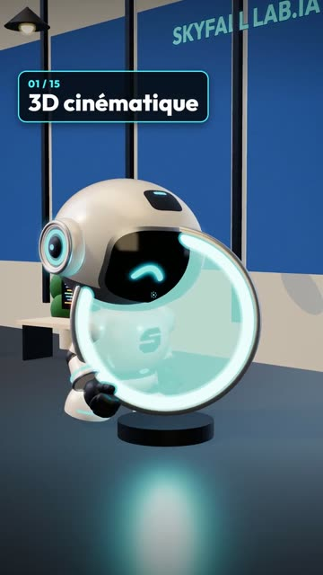 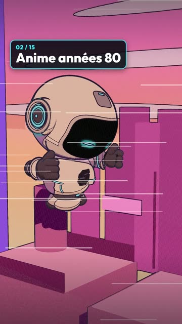 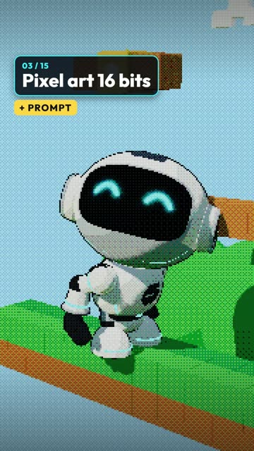 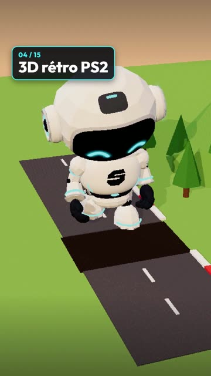 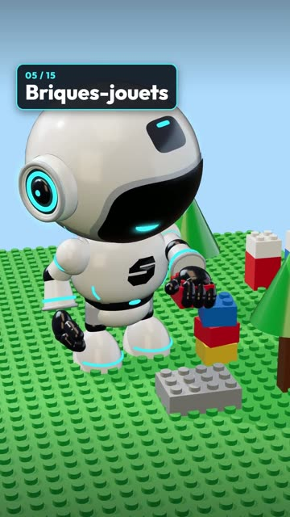 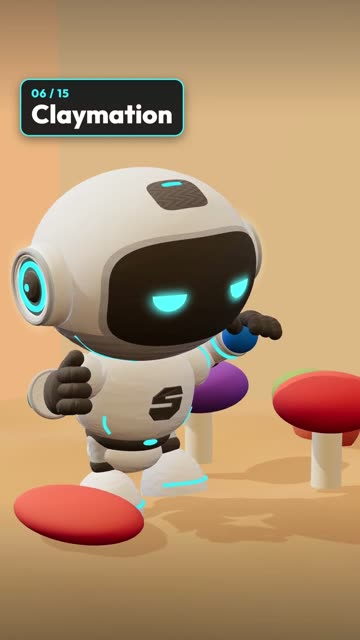 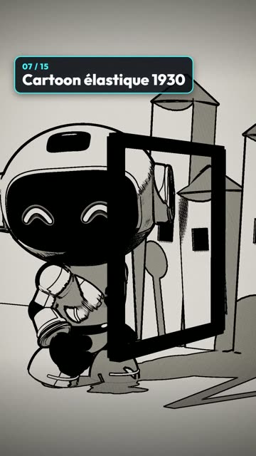 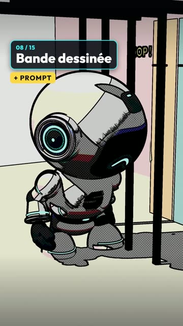 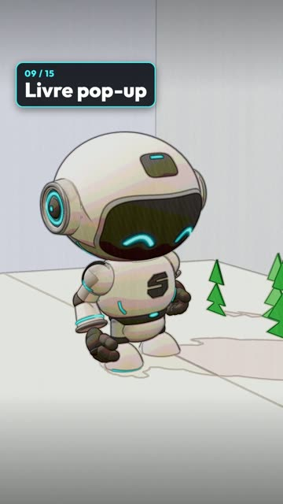 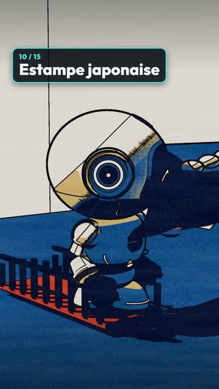 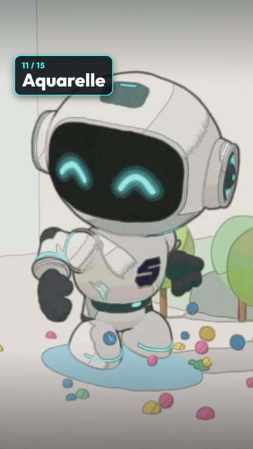 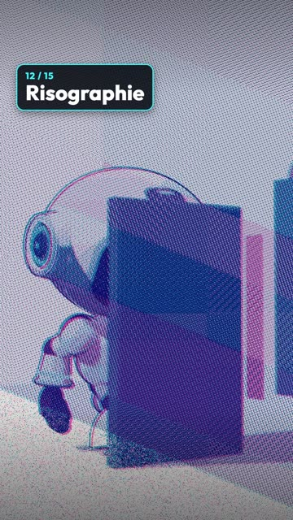 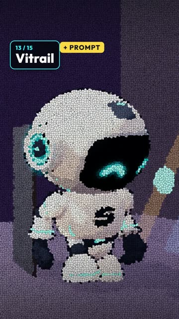 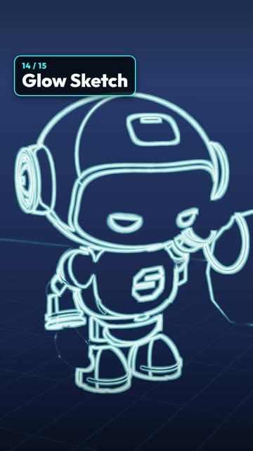 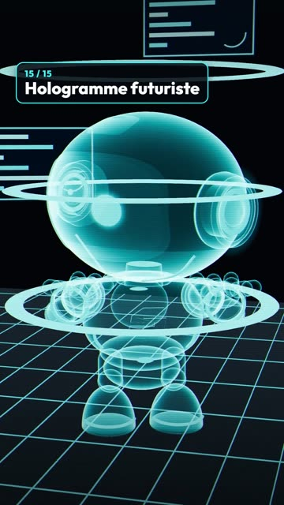

## ⚡ En 30 secondes

1. Choisis un style ci-dessous (ou dans les [catégories](#les-110-styles)).
2. Copie le **prompt image**, remplace `[PERSONNAGE]` et `[SCÈNE]`, génère ton image.
3. Copie le **prompt animation** dans ton outil image-vers-vidéo, ou le **prompt code** dans Claude Code / ChatGPT.

👉 Le mode d'emploi complet, avec les astuces pour garder le même personnage : **[GUIDE.md](GUIDE.md)**.

## Les 15 styles de la vidéo

| # | Style | Rendu |
|---|---|---|
| 1 | [CGI cinématographique](categories/16-styles-complementaires.md#cgi-cinématographique) | rendu 3D premium, matériaux réalistes, profondeur de champ et lumière dramatique |
| 2 | [Anime sur celluloïd années 1980](categories/08-dessins-animes.md#anime-sur-celluloïd-années-1980) | ombres franches, arrière-plan peint et mouvement sur poses-clés |
| 3 | [RPG pixel 16 bits](categories/09-jeux-video.md#rpg-pixel-16-bits) | pixels nets, palette limitée, sprites animés par étapes et menus rétro |
| 4 | [Jeu 3D rétro PS2](categories/16-styles-complementaires.md#jeu-3d-rétro-ps2) | géométrie 3D simplifiée, textures basse résolution, léger brouillard de distance |
| 5 | [Univers de briques-jouets](categories/13-3d-miniatures.md#univers-de-briques-jouets) | assemblages de pièces plastique, tenons visibles et éclairage de maquette |
| 6 | [Claymation](categories/16-styles-complementaires.md#claymation) | pâte à modeler artisanale, empreintes digitales et lumière de plateau |
| 7 | [Cartoon élastique années 1930](categories/08-dessins-animes.md#cartoon-élastique-années-1930) | membres extensibles, rebond exagéré, noir et blanc et grain de film |
| 8 | [Cases manga](categories/08-dessins-animes.md#cases-manga) | noir et blanc très contrasté, trames et composition de planches |
| 9 | [Livre pop-up](categories/13-3d-miniatures.md#livre-pop-up) | personnages en cartes découpées, pliures articulées et caméra macro |
| 10 | [Estampe japonaise](categories/04-arts-traditionnels.md#estampe-japonaise) | aplats de couleur, lignes gravées, vagues stylisées et papier vieilli |
| 11 | [Aquarelle](categories/02-peinture-illustration.md#aquarelle) | lavis diffus, pigments qui fusent et blancs réservés |
| 12 | [Risographie](categories/05-impression-gravure.md#risographie) | deux à trois encres superposées, trame irrégulière et léger décalage d'impression |
| 13 | [Vitrail](categories/04-arts-traditionnels.md#vitrail) | pièces de verre coloré, plomb sombre, lumière traversante et mosaïque |
| 14 | [Glow Sketch](categories/16-styles-complementaires.md#glow-sketch) | traits lumineux cyan/or sur noir profond et volumes suggérés |
| 15 | [Interface holographique](categories/11-ecrans-interfaces.md#interface-holographique) | couches translucides cyan, jauges de fiction et profondeur optique |

## Les 110 styles

| Catégorie | Styles | Exemples |
|---|---|---|
| [Montage & documentaire](categories/01-montage-documentaire.md) | 8 | Flash info sous-titré, Actualités des années 1920, Décompte en écrans partagés… |
| [Peinture & illustration](categories/02-peinture-illustration.md) | 5 | Album au crayon, Aquarelle, Peinture à l'huile épaisse… |
| [Croquis & tableaux](categories/03-croquis-tableaux.md) | 7 | Dessin en un trait, Tableau blanc, Tableau à la craie… |
| [Arts traditionnels](categories/04-arts-traditionnels.md) | 7 | Lavis à l'encre, Théâtre d'ombres, Estampe japonaise… |
| [Impression & gravure](categories/05-impression-gravure.md) | 8 | Risographie, Dossier en trame demi-teinte, Gravure sur bois… |
| [Graphisme & typographie](categories/06-graphisme-typographie.md) | 8 | Graphisme suisse animé, Générique d'espionnage rétro, Art déco… |
| [Plans & schémas](categories/07-plans-schemas.md) | 8 | Plan d'ingénieur, Infographie isométrique, Vue éclatée technique… |
| [Dessins animés](categories/08-dessins-animes.md) | 6 | Cartoon élastique années 1930, Anime sur celluloïd années 1980, Cartoon science-fiction… |
| [Jeux vidéo](categories/09-jeux-video.md) | 4 | RPG pixel 16 bits, Pixel art en profondeur 2,5D, Microjeu ultra-court… |
| [Pellicules & écrans anciens](categories/10-pellicules-ecrans-anciens.md) | 5 | Terminal ASCII CRT, Cinéma muet, Vidéo analogique liminale… |
| [Écrans & interfaces](categories/11-ecrans-interfaces.md) | 6 | Présentation tech sombre, Mascotte dans une capture d'écran, Interface holographique… |
| [Lumière & lignes](categories/12-lumiere-lignes.md) | 5 | Circuits imprimés, Pointillisme lumineux, Lignes de champ… |
| [3D & miniatures](categories/13-3d-miniatures.md) | 8 | Univers de briques-jouets, Livre pop-up, Miniature en bascule-décentrement… |
| [Instruments & preuves](categories/14-instruments-preuves.md) | 8 | Briefing satellite, Panneau d'ingénierie, Nuage de points LiDAR… |
| [Données & cartes](categories/15-donnees-cartes.md) | 6 | Visualisation de données, Projection sur maquette blanche, Données matérialisées… |
| [Styles complémentaires](categories/16-styles-complementaires.md) | 11 | Glow Sketch, Jeu 3D rétro PS2, Claymation… |

Version tableur : [`styles.csv`](styles.csv) · version données : [`styles.json`](styles.json).

## Bon à savoir

- **330 prompts originaux**, rédigés par Skyfall Lab.IA, **préparés mais pas encore testés** dans chaque outil : les
  résultats varient selon le générateur.
- Les images d'exemple viennent de notre vidéo, réalisée avec notre pipeline 3D ; elles n'ont pas été générées par ces prompts.
- N'utilise pas ces prompts pour copier un personnage, une marque ou une œuvre protégée.
- Sources d'inspiration et crédits : [SOURCES.md](SOURCES.md) · Licence : [CC BY 4.0](LICENSE.md) (cite « Skyfall Lab.IA »).

Tu as créé quelque chose avec un de ces prompts ? Identifie **@skyfalllab.ia**, on adore voir vos animations. ✨
