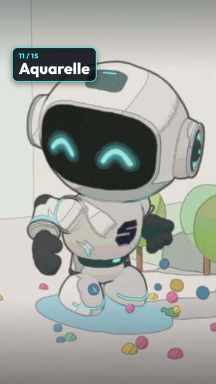

# 02 · Peinture & illustration

[← Tous les styles](../README.md#les-110-styles) · 5 styles

- [Album au crayon](#album-au-crayon)
- [Aquarelle](#aquarelle)
- [Peinture à l'huile épaisse](#peinture-à-lhuile-épaisse)
- [Carnet urbain](#carnet-urbain)
- [Illustration aux crayons de couleur](#illustration-aux-crayons-de-couleur)

## Album au crayon

**Rendu :** tracé gras texturé, papier apparent et couleurs chaleureuses non uniformes.

**1. Prompt image** (remplace les crochets)

```text
Image verticale 9:16. Style « Album au crayon » : tracé gras texturé, papier apparent et couleurs chaleureuses non uniformes.
Sujet : [PERSONNAGE — décris-le en une phrase : silhouette, couleurs, vêtements, signe distinctif], dans [SCÈNE — lieu, moment, lumière].
Moment représenté : juste avant l'action — [PERSONNAGE] tourne une page et le dessin prend vie.
Composition lisible sur téléphone : personnage entier ou jusqu'aux genoux, mains visibles, silhouette claire, décor et objets originaux, éclairage cohérent avec le style.
À éviter : texte ou lettres générés, logos et marques, personnages existants, membres en trop, visage déformé.
```

**2. Prompt animation** (à partir de l'image obtenue)

```text
À partir de l'image fournie, crée un plan vertical de 3 à 5 secondes dans le style « Album au crayon » (tracé gras texturé, papier apparent et couleurs chaleureuses non uniformes).
Action unique et complète : [PERSONNAGE] tourne une page et le dessin prend vie — avec une préparation du geste, le contact, la conséquence visible et une réaction.
Mouvement : gestes lents et amples, matière picturale qui « respire » légèrement d'une image à l'autre.
Caméra : poussée douce ou panoramique lent.
Garde le même personnage, les mêmes couleurs et les mêmes proportions du début à la fin ; aucun texte, aucun logo.
```

**3. Prompt pour l'animer en code** (Claude Code, ChatGPT, Codex…)

```text
Tu es un développeur d'animation. Avec Remotion (React) ou Three.js, crée une animation verticale 1080×1920 de 5 secondes à 30 i/s dans le style « Album au crayon » : tracé gras texturé, papier apparent et couleurs chaleureuses non uniformes.
Personnage : [PERSONNAGE — formes simples à construire en code, couleurs principales]. Scène : [SCÈNE].
Action : [PERSONNAGE] tourne une page et le dessin prend vie (préparation, geste, conséquence, réaction ; le personnage se déplace et ses membres bougent, pas seulement la caméra).
Mouvement : gestes lents et amples, matière picturale qui « respire » légèrement d'une image à l'autre. Caméra : poussée douce ou panoramique lent.
Contraintes : rendu déterministe (aucun Math.random non initialisé), aucune ressource payante ni téléchargement, pas de texte généré dans l'image, code commenté et une commande pour exporter le MP4.
```

**Mouvement :** gestes lents et amples, matière picturale qui « respire » légèrement d'une image à l'autre.  
**Caméra :** poussée douce ou panoramique lent.  
**Outils :** générateur d'images puis image-vers-vidéo, ou motion design / 3D.  
**Limites :** les générateurs vidéo font scintiller la texture : préférer des plans courts (3 à 4 s).  
**Statut :** prompt préparé, non testé.  
**Référence de style :** [Lemo-Opuscar](https://github.com/lemomo-ai/lemo-opuscar/blob/main/styles/crayon-book/STYLE.md)

## Aquarelle

**Rendu :** lavis diffus, pigments qui fusent et blancs réservés.



*Exemple : image de notre vidéo, réalisée avec notre pipeline 3D (pas générée par ce prompt).*

**1. Prompt image** (remplace les crochets)

```text
Image verticale 9:16. Style « Aquarelle » : lavis diffus, pigments qui fusent et blancs réservés.
Sujet : [PERSONNAGE — décris-le en une phrase : silhouette, couleurs, vêtements, signe distinctif], dans [SCÈNE — lieu, moment, lumière].
Moment représenté : juste avant l'action — [PERSONNAGE] effleure une tache d'eau et le décor apparaît.
Composition lisible sur téléphone : personnage entier ou jusqu'aux genoux, mains visibles, silhouette claire, décor et objets originaux, éclairage cohérent avec le style.
À éviter : texte ou lettres générés, logos et marques, personnages existants, membres en trop, visage déformé.
```

**2. Prompt animation** (à partir de l'image obtenue)

```text
À partir de l'image fournie, crée un plan vertical de 3 à 5 secondes dans le style « Aquarelle » (lavis diffus, pigments qui fusent et blancs réservés).
Action unique et complète : [PERSONNAGE] effleure une tache d'eau et le décor apparaît — avec une préparation du geste, le contact, la conséquence visible et une réaction.
Mouvement : gestes lents et amples, matière picturale qui « respire » légèrement d'une image à l'autre.
Caméra : poussée douce ou panoramique lent.
Garde le même personnage, les mêmes couleurs et les mêmes proportions du début à la fin ; aucun texte, aucun logo.
```

**3. Prompt pour l'animer en code** (Claude Code, ChatGPT, Codex…)

```text
Tu es un développeur d'animation. Avec Remotion (React) ou Three.js, crée une animation verticale 1080×1920 de 5 secondes à 30 i/s dans le style « Aquarelle » : lavis diffus, pigments qui fusent et blancs réservés.
Personnage : [PERSONNAGE — formes simples à construire en code, couleurs principales]. Scène : [SCÈNE].
Action : [PERSONNAGE] effleure une tache d'eau et le décor apparaît (préparation, geste, conséquence, réaction ; le personnage se déplace et ses membres bougent, pas seulement la caméra).
Mouvement : gestes lents et amples, matière picturale qui « respire » légèrement d'une image à l'autre. Caméra : poussée douce ou panoramique lent.
Contraintes : rendu déterministe (aucun Math.random non initialisé), aucune ressource payante ni téléchargement, pas de texte généré dans l'image, code commenté et une commande pour exporter le MP4.
```

**Mouvement :** gestes lents et amples, matière picturale qui « respire » légèrement d'une image à l'autre.  
**Caméra :** poussée douce ou panoramique lent.  
**Outils :** générateur d'images puis image-vers-vidéo, ou motion design / 3D.  
**Limites :** les générateurs vidéo font scintiller la texture : préférer des plans courts (3 à 4 s).  
**Statut :** prompt préparé, non testé.  
**Référence de style :** [Lemo-Opuscar](https://github.com/lemomo-ai/lemo-opuscar/blob/main/styles/watercolor/STYLE.md)

## Peinture à l'huile épaisse

**Rendu :** relief de coups de pinceau, matière épaisse et reflets sur la peinture.

**1. Prompt image** (remplace les crochets)

```text
Image verticale 9:16. Style « Peinture à l'huile épaisse » : relief de coups de pinceau, matière épaisse et reflets sur la peinture.
Sujet : [PERSONNAGE — décris-le en une phrase : silhouette, couleurs, vêtements, signe distinctif], dans [SCÈNE — lieu, moment, lumière].
Moment représenté : juste avant l'action — [PERSONNAGE] pose un pinceau et la couleur suit sa trajectoire.
Composition lisible sur téléphone : personnage entier ou jusqu'aux genoux, mains visibles, silhouette claire, décor et objets originaux, éclairage cohérent avec le style.
À éviter : texte ou lettres générés, logos et marques, personnages existants, membres en trop, visage déformé.
```

**2. Prompt animation** (à partir de l'image obtenue)

```text
À partir de l'image fournie, crée un plan vertical de 3 à 5 secondes dans le style « Peinture à l'huile épaisse » (relief de coups de pinceau, matière épaisse et reflets sur la peinture).
Action unique et complète : [PERSONNAGE] pose un pinceau et la couleur suit sa trajectoire — avec une préparation du geste, le contact, la conséquence visible et une réaction.
Mouvement : gestes lents et amples, matière picturale qui « respire » légèrement d'une image à l'autre.
Caméra : poussée douce ou panoramique lent.
Garde le même personnage, les mêmes couleurs et les mêmes proportions du début à la fin ; aucun texte, aucun logo.
```

**3. Prompt pour l'animer en code** (Claude Code, ChatGPT, Codex…)

```text
Tu es un développeur d'animation. Avec Remotion (React) ou Three.js, crée une animation verticale 1080×1920 de 5 secondes à 30 i/s dans le style « Peinture à l'huile épaisse » : relief de coups de pinceau, matière épaisse et reflets sur la peinture.
Personnage : [PERSONNAGE — formes simples à construire en code, couleurs principales]. Scène : [SCÈNE].
Action : [PERSONNAGE] pose un pinceau et la couleur suit sa trajectoire (préparation, geste, conséquence, réaction ; le personnage se déplace et ses membres bougent, pas seulement la caméra).
Mouvement : gestes lents et amples, matière picturale qui « respire » légèrement d'une image à l'autre. Caméra : poussée douce ou panoramique lent.
Contraintes : rendu déterministe (aucun Math.random non initialisé), aucune ressource payante ni téléchargement, pas de texte généré dans l'image, code commenté et une commande pour exporter le MP4.
```

**Mouvement :** gestes lents et amples, matière picturale qui « respire » légèrement d'une image à l'autre.  
**Caméra :** poussée douce ou panoramique lent.  
**Outils :** générateur d'images puis image-vers-vidéo, ou motion design / 3D.  
**Limites :** les générateurs vidéo font scintiller la texture : préférer des plans courts (3 à 4 s).  
**Statut :** prompt préparé, non testé.  
**Référence de style :** [Lemo-Opuscar](https://github.com/lemomo-ai/lemo-opuscar/blob/main/styles/impasto/STYLE.md)

## Carnet urbain

**Rendu :** encre fine, perspective libre, taches d'aquarelle et papier de croquis.

**1. Prompt image** (remplace les crochets)

```text
Image verticale 9:16. Style « Carnet urbain » : encre fine, perspective libre, taches d'aquarelle et papier de croquis.
Sujet : [PERSONNAGE — décris-le en une phrase : silhouette, couleurs, vêtements, signe distinctif], dans [SCÈNE — lieu, moment, lumière].
Moment représenté : juste avant l'action — [PERSONNAGE] esquisse un immeuble, puis saute dans son croquis.
Composition lisible sur téléphone : personnage entier ou jusqu'aux genoux, mains visibles, silhouette claire, décor et objets originaux, éclairage cohérent avec le style.
À éviter : texte ou lettres générés, logos et marques, personnages existants, membres en trop, visage déformé.
```

**2. Prompt animation** (à partir de l'image obtenue)

```text
À partir de l'image fournie, crée un plan vertical de 3 à 5 secondes dans le style « Carnet urbain » (encre fine, perspective libre, taches d'aquarelle et papier de croquis).
Action unique et complète : [PERSONNAGE] esquisse un immeuble, puis saute dans son croquis — avec une préparation du geste, le contact, la conséquence visible et une réaction.
Mouvement : gestes lents et amples, matière picturale qui « respire » légèrement d'une image à l'autre.
Caméra : poussée douce ou panoramique lent.
Garde le même personnage, les mêmes couleurs et les mêmes proportions du début à la fin ; aucun texte, aucun logo.
```

**3. Prompt pour l'animer en code** (Claude Code, ChatGPT, Codex…)

```text
Tu es un développeur d'animation. Avec Remotion (React) ou Three.js, crée une animation verticale 1080×1920 de 5 secondes à 30 i/s dans le style « Carnet urbain » : encre fine, perspective libre, taches d'aquarelle et papier de croquis.
Personnage : [PERSONNAGE — formes simples à construire en code, couleurs principales]. Scène : [SCÈNE].
Action : [PERSONNAGE] esquisse un immeuble, puis saute dans son croquis (préparation, geste, conséquence, réaction ; le personnage se déplace et ses membres bougent, pas seulement la caméra).
Mouvement : gestes lents et amples, matière picturale qui « respire » légèrement d'une image à l'autre. Caméra : poussée douce ou panoramique lent.
Contraintes : rendu déterministe (aucun Math.random non initialisé), aucune ressource payante ni téléchargement, pas de texte généré dans l'image, code commenté et une commande pour exporter le MP4.
```

**Mouvement :** gestes lents et amples, matière picturale qui « respire » légèrement d'une image à l'autre.  
**Caméra :** poussée douce ou panoramique lent.  
**Outils :** générateur d'images puis image-vers-vidéo, ou motion design / 3D.  
**Limites :** les générateurs vidéo font scintiller la texture : préférer des plans courts (3 à 4 s).  
**Statut :** prompt préparé, non testé.  
**Référence de style :** [Lemo-Opuscar](https://github.com/lemomo-ai/lemo-opuscar/blob/main/styles/urban-sketch/STYLE.md)

## Illustration aux crayons de couleur

**Rendu :** hachures colorées superposées, contours fins et annotations pédagogiques.

**1. Prompt image** (remplace les crochets)

```text
Image verticale 9:16. Style « Illustration aux crayons de couleur » : hachures colorées superposées, contours fins et annotations pédagogiques.
Sujet : [PERSONNAGE — décris-le en une phrase : silhouette, couleurs, vêtements, signe distinctif], dans [SCÈNE — lieu, moment, lumière].
Moment représenté : juste avant l'action — [PERSONNAGE] colore progressivement une fleur mécanique fictive.
Composition lisible sur téléphone : personnage entier ou jusqu'aux genoux, mains visibles, silhouette claire, décor et objets originaux, éclairage cohérent avec le style.
À éviter : texte ou lettres générés, logos et marques, personnages existants, membres en trop, visage déformé.
```

**2. Prompt animation** (à partir de l'image obtenue)

```text
À partir de l'image fournie, crée un plan vertical de 3 à 5 secondes dans le style « Illustration aux crayons de couleur » (hachures colorées superposées, contours fins et annotations pédagogiques).
Action unique et complète : [PERSONNAGE] colore progressivement une fleur mécanique fictive — avec une préparation du geste, le contact, la conséquence visible et une réaction.
Mouvement : gestes lents et amples, matière picturale qui « respire » légèrement d'une image à l'autre.
Caméra : poussée douce ou panoramique lent.
Garde le même personnage, les mêmes couleurs et les mêmes proportions du début à la fin ; aucun texte, aucun logo.
```

**3. Prompt pour l'animer en code** (Claude Code, ChatGPT, Codex…)

```text
Tu es un développeur d'animation. Avec Remotion (React) ou Three.js, crée une animation verticale 1080×1920 de 5 secondes à 30 i/s dans le style « Illustration aux crayons de couleur » : hachures colorées superposées, contours fins et annotations pédagogiques.
Personnage : [PERSONNAGE — formes simples à construire en code, couleurs principales]. Scène : [SCÈNE].
Action : [PERSONNAGE] colore progressivement une fleur mécanique fictive (préparation, geste, conséquence, réaction ; le personnage se déplace et ses membres bougent, pas seulement la caméra).
Mouvement : gestes lents et amples, matière picturale qui « respire » légèrement d'une image à l'autre. Caméra : poussée douce ou panoramique lent.
Contraintes : rendu déterministe (aucun Math.random non initialisé), aucune ressource payante ni téléchargement, pas de texte généré dans l'image, code commenté et une commande pour exporter le MP4.
```

**Mouvement :** gestes lents et amples, matière picturale qui « respire » légèrement d'une image à l'autre.  
**Caméra :** poussée douce ou panoramique lent.  
**Outils :** générateur d'images puis image-vers-vidéo, ou motion design / 3D.  
**Limites :** les générateurs vidéo font scintiller la texture : préférer des plans courts (3 à 4 s).  
**Statut :** prompt préparé, non testé.  
**Référence de style :** [Lemo-Opuscar](https://github.com/lemomo-ai/lemo-opuscar/blob/main/styles/colored-pencil/STYLE.md)

