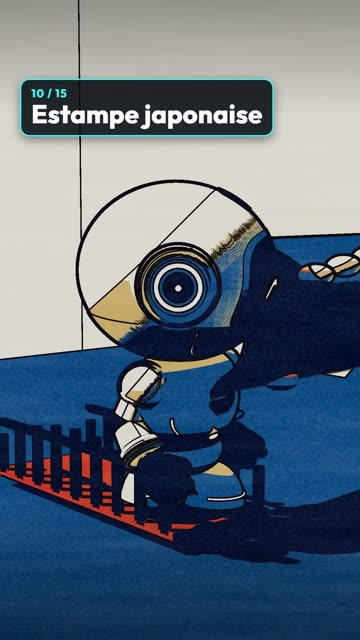
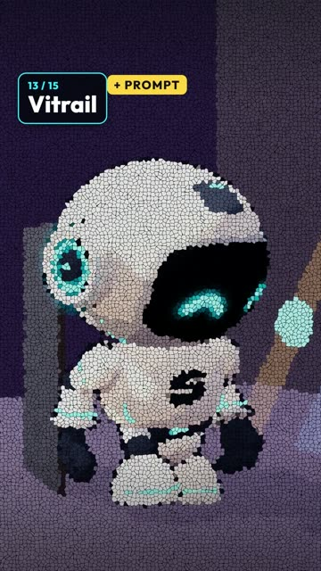

# 04 · Arts traditionnels

[← Tous les styles](../README.md#les-110-styles) · 7 styles

- [Lavis à l'encre](#lavis-à-lencre)
- [Théâtre d'ombres](#théâtre-dombres)
- [Estampe japonaise](#estampe-japonaise)
- [Papier découpé rouge](#papier-découpé-rouge)
- [Boîte à lumière en papier](#boîte-à-lumière-en-papier)
- [Vitrail](#vitrail)
- [Enluminure dorée](#enluminure-dorée)

## Lavis à l'encre

**Rendu :** dégradés d'encre noire, diffusion sur papier de riz et grands espaces vides.

**1. Prompt image** (remplace les crochets)

```text
Image verticale 9:16. Style « Lavis à l'encre » : dégradés d'encre noire, diffusion sur papier de riz et grands espaces vides.
Sujet : [PERSONNAGE — décris-le en une phrase : silhouette, couleurs, vêtements, signe distinctif], dans [SCÈNE — lieu, moment, lumière].
Moment représenté : juste avant l'action — [PERSONNAGE] glisse sur un pont de brume dessiné à l'encre.
Composition lisible sur téléphone : personnage entier ou jusqu'aux genoux, mains visibles, silhouette claire, décor et objets originaux, éclairage cohérent avec le style.
À éviter : texte ou lettres générés, logos et marques, personnages existants, membres en trop, visage déformé.
```

**2. Prompt animation** (à partir de l'image obtenue)

```text
À partir de l'image fournie, crée un plan vertical de 3 à 5 secondes dans le style « Lavis à l'encre » (dégradés d'encre noire, diffusion sur papier de riz et grands espaces vides).
Action unique et complète : [PERSONNAGE] glisse sur un pont de brume dessiné à l'encre — avec une préparation du geste, le contact, la conséquence visible et une réaction.
Mouvement : animation limitée (poses tenues, découpes qui pivotent), rythme posé.
Caméra : plan large et frontal, comme une scène.
Garde le même personnage, les mêmes couleurs et les mêmes proportions du début à la fin ; aucun texte, aucun logo.
```

**3. Prompt pour l'animer en code** (Claude Code, ChatGPT, Codex…)

```text
Tu es un développeur d'animation. Avec Remotion (React) ou Three.js, crée une animation verticale 1080×1920 de 5 secondes à 30 i/s dans le style « Lavis à l'encre » : dégradés d'encre noire, diffusion sur papier de riz et grands espaces vides.
Personnage : [PERSONNAGE — formes simples à construire en code, couleurs principales]. Scène : [SCÈNE].
Action : [PERSONNAGE] glisse sur un pont de brume dessiné à l'encre (préparation, geste, conséquence, réaction ; le personnage se déplace et ses membres bougent, pas seulement la caméra).
Mouvement : animation limitée (poses tenues, découpes qui pivotent), rythme posé. Caméra : plan large et frontal, comme une scène.
Contraintes : rendu déterministe (aucun Math.random non initialisé), aucune ressource payante ni téléchargement, pas de texte généré dans l'image, code commenté et une commande pour exporter le MP4.
```

**Mouvement :** animation limitée (poses tenues, découpes qui pivotent), rythme posé.  
**Caméra :** plan large et frontal, comme une scène.  
**Outils :** générateur d'images puis image-vers-vidéo, ou motion design / 3D.  
**Limites :** s'inspirer de la technique, pas d'une œuvre précise ; respecter les traditions culturelles.  
**Statut :** prompt préparé, non testé.  
**Référence de style :** [Lemo-Opuscar](https://github.com/lemomo-ai/lemo-opuscar/blob/main/styles/ink-wash/STYLE.md)

## Théâtre d'ombres

**Rendu :** silhouettes découpées et articulées, lumière arrière et décor de scène.

**1. Prompt image** (remplace les crochets)

```text
Image verticale 9:16. Style « Théâtre d'ombres » : silhouettes découpées et articulées, lumière arrière et décor de scène.
Sujet : [PERSONNAGE — décris-le en une phrase : silhouette, couleurs, vêtements, signe distinctif], dans [SCÈNE — lieu, moment, lumière].
Moment représenté : juste avant l'action — [PERSONNAGE] actionne une silhouette puis échange sa place avec elle.
Composition lisible sur téléphone : personnage entier ou jusqu'aux genoux, mains visibles, silhouette claire, décor et objets originaux, éclairage cohérent avec le style.
À éviter : texte ou lettres générés, logos et marques, personnages existants, membres en trop, visage déformé.
```

**2. Prompt animation** (à partir de l'image obtenue)

```text
À partir de l'image fournie, crée un plan vertical de 3 à 5 secondes dans le style « Théâtre d'ombres » (silhouettes découpées et articulées, lumière arrière et décor de scène).
Action unique et complète : [PERSONNAGE] actionne une silhouette puis échange sa place avec elle — avec une préparation du geste, le contact, la conséquence visible et une réaction.
Mouvement : animation limitée (poses tenues, découpes qui pivotent), rythme posé.
Caméra : plan large et frontal, comme une scène.
Garde le même personnage, les mêmes couleurs et les mêmes proportions du début à la fin ; aucun texte, aucun logo.
```

**3. Prompt pour l'animer en code** (Claude Code, ChatGPT, Codex…)

```text
Tu es un développeur d'animation. Avec Remotion (React) ou Three.js, crée une animation verticale 1080×1920 de 5 secondes à 30 i/s dans le style « Théâtre d'ombres » : silhouettes découpées et articulées, lumière arrière et décor de scène.
Personnage : [PERSONNAGE — formes simples à construire en code, couleurs principales]. Scène : [SCÈNE].
Action : [PERSONNAGE] actionne une silhouette puis échange sa place avec elle (préparation, geste, conséquence, réaction ; le personnage se déplace et ses membres bougent, pas seulement la caméra).
Mouvement : animation limitée (poses tenues, découpes qui pivotent), rythme posé. Caméra : plan large et frontal, comme une scène.
Contraintes : rendu déterministe (aucun Math.random non initialisé), aucune ressource payante ni téléchargement, pas de texte généré dans l'image, code commenté et une commande pour exporter le MP4.
```

**Mouvement :** animation limitée (poses tenues, découpes qui pivotent), rythme posé.  
**Caméra :** plan large et frontal, comme une scène.  
**Outils :** générateur d'images puis image-vers-vidéo, ou motion design / 3D.  
**Limites :** s'inspirer de la technique, pas d'une œuvre précise ; respecter les traditions culturelles.  
**Statut :** prompt préparé, non testé.  
**Référence de style :** [Lemo-Opuscar](https://github.com/lemomo-ai/lemo-opuscar/blob/main/styles/shadow-puppet/STYLE.md)

## Estampe japonaise

**Rendu :** aplats de couleur, lignes gravées, vagues stylisées et papier vieilli.



*Exemple : image de notre vidéo, réalisée avec notre pipeline 3D (pas générée par ce prompt).*

**1. Prompt image** (remplace les crochets)

```text
Image verticale 9:16. Style « Estampe japonaise » : aplats de couleur, lignes gravées, vagues stylisées et papier vieilli.
Sujet : [PERSONNAGE — décris-le en une phrase : silhouette, couleurs, vêtements, signe distinctif], dans [SCÈNE — lieu, moment, lumière].
Moment représenté : juste avant l'action — [PERSONNAGE] saute par-dessus une vague stylisée.
Composition lisible sur téléphone : personnage entier ou jusqu'aux genoux, mains visibles, silhouette claire, décor et objets originaux, éclairage cohérent avec le style.
À éviter : texte ou lettres générés, logos et marques, personnages existants, membres en trop, visage déformé.
```

**2. Prompt animation** (à partir de l'image obtenue)

```text
À partir de l'image fournie, crée un plan vertical de 3 à 5 secondes dans le style « Estampe japonaise » (aplats de couleur, lignes gravées, vagues stylisées et papier vieilli).
Action unique et complète : [PERSONNAGE] saute par-dessus une vague stylisée — avec une préparation du geste, le contact, la conséquence visible et une réaction.
Mouvement : animation limitée (poses tenues, découpes qui pivotent), rythme posé.
Caméra : plan large et frontal, comme une scène.
Garde le même personnage, les mêmes couleurs et les mêmes proportions du début à la fin ; aucun texte, aucun logo.
```

**3. Prompt pour l'animer en code** (Claude Code, ChatGPT, Codex…)

```text
Tu es un développeur d'animation. Avec Remotion (React) ou Three.js, crée une animation verticale 1080×1920 de 5 secondes à 30 i/s dans le style « Estampe japonaise » : aplats de couleur, lignes gravées, vagues stylisées et papier vieilli.
Personnage : [PERSONNAGE — formes simples à construire en code, couleurs principales]. Scène : [SCÈNE].
Action : [PERSONNAGE] saute par-dessus une vague stylisée (préparation, geste, conséquence, réaction ; le personnage se déplace et ses membres bougent, pas seulement la caméra).
Mouvement : animation limitée (poses tenues, découpes qui pivotent), rythme posé. Caméra : plan large et frontal, comme une scène.
Contraintes : rendu déterministe (aucun Math.random non initialisé), aucune ressource payante ni téléchargement, pas de texte généré dans l'image, code commenté et une commande pour exporter le MP4.
```

**Mouvement :** animation limitée (poses tenues, découpes qui pivotent), rythme posé.  
**Caméra :** plan large et frontal, comme une scène.  
**Outils :** générateur d'images puis image-vers-vidéo, ou motion design / 3D.  
**Limites :** s'inspirer de la technique, pas d'une œuvre précise ; respecter les traditions culturelles.  
**Statut :** prompt préparé, non testé.  
**Référence de style :** [Lemo-Opuscar](https://github.com/lemomo-ai/lemo-opuscar/blob/main/styles/ukiyoe/STYLE.md)

## Papier découpé rouge

**Rendu :** symétries découpées dans le rouge, contre-jour clair et contours francs.

**1. Prompt image** (remplace les crochets)

```text
Image verticale 9:16. Style « Papier découpé rouge » : symétries découpées dans le rouge, contre-jour clair et contours francs.
Sujet : [PERSONNAGE — décris-le en une phrase : silhouette, couleurs, vêtements, signe distinctif], dans [SCÈNE — lieu, moment, lumière].
Moment représenté : juste avant l'action — [PERSONNAGE] ouvre un motif découpé comme un rideau.
Composition lisible sur téléphone : personnage entier ou jusqu'aux genoux, mains visibles, silhouette claire, décor et objets originaux, éclairage cohérent avec le style.
À éviter : texte ou lettres générés, logos et marques, personnages existants, membres en trop, visage déformé.
```

**2. Prompt animation** (à partir de l'image obtenue)

```text
À partir de l'image fournie, crée un plan vertical de 3 à 5 secondes dans le style « Papier découpé rouge » (symétries découpées dans le rouge, contre-jour clair et contours francs).
Action unique et complète : [PERSONNAGE] ouvre un motif découpé comme un rideau — avec une préparation du geste, le contact, la conséquence visible et une réaction.
Mouvement : animation limitée (poses tenues, découpes qui pivotent), rythme posé.
Caméra : plan large et frontal, comme une scène.
Garde le même personnage, les mêmes couleurs et les mêmes proportions du début à la fin ; aucun texte, aucun logo.
```

**3. Prompt pour l'animer en code** (Claude Code, ChatGPT, Codex…)

```text
Tu es un développeur d'animation. Avec Remotion (React) ou Three.js, crée une animation verticale 1080×1920 de 5 secondes à 30 i/s dans le style « Papier découpé rouge » : symétries découpées dans le rouge, contre-jour clair et contours francs.
Personnage : [PERSONNAGE — formes simples à construire en code, couleurs principales]. Scène : [SCÈNE].
Action : [PERSONNAGE] ouvre un motif découpé comme un rideau (préparation, geste, conséquence, réaction ; le personnage se déplace et ses membres bougent, pas seulement la caméra).
Mouvement : animation limitée (poses tenues, découpes qui pivotent), rythme posé. Caméra : plan large et frontal, comme une scène.
Contraintes : rendu déterministe (aucun Math.random non initialisé), aucune ressource payante ni téléchargement, pas de texte généré dans l'image, code commenté et une commande pour exporter le MP4.
```

**Mouvement :** animation limitée (poses tenues, découpes qui pivotent), rythme posé.  
**Caméra :** plan large et frontal, comme une scène.  
**Outils :** générateur d'images puis image-vers-vidéo, ou motion design / 3D.  
**Limites :** s'inspirer de la technique, pas d'une œuvre précise ; respecter les traditions culturelles.  
**Statut :** prompt préparé, non testé.  
**Référence de style :** [Lemo-Opuscar](https://github.com/lemomo-ai/lemo-opuscar/blob/main/styles/papercut-red/STYLE.md)

## Boîte à lumière en papier

**Rendu :** couches de papier translucide, ombres de profondeur et lueur chaude.

**1. Prompt image** (remplace les crochets)

```text
Image verticale 9:16. Style « Boîte à lumière en papier » : couches de papier translucide, ombres de profondeur et lueur chaude.
Sujet : [PERSONNAGE — décris-le en une phrase : silhouette, couleurs, vêtements, signe distinctif], dans [SCÈNE — lieu, moment, lumière].
Moment représenté : juste avant l'action — [PERSONNAGE] écarte des couches lumineuses pour révéler une scène.
Composition lisible sur téléphone : personnage entier ou jusqu'aux genoux, mains visibles, silhouette claire, décor et objets originaux, éclairage cohérent avec le style.
À éviter : texte ou lettres générés, logos et marques, personnages existants, membres en trop, visage déformé.
```

**2. Prompt animation** (à partir de l'image obtenue)

```text
À partir de l'image fournie, crée un plan vertical de 3 à 5 secondes dans le style « Boîte à lumière en papier » (couches de papier translucide, ombres de profondeur et lueur chaude).
Action unique et complète : [PERSONNAGE] écarte des couches lumineuses pour révéler une scène — avec une préparation du geste, le contact, la conséquence visible et une réaction.
Mouvement : animation limitée (poses tenues, découpes qui pivotent), rythme posé.
Caméra : plan large et frontal, comme une scène.
Garde le même personnage, les mêmes couleurs et les mêmes proportions du début à la fin ; aucun texte, aucun logo.
```

**3. Prompt pour l'animer en code** (Claude Code, ChatGPT, Codex…)

```text
Tu es un développeur d'animation. Avec Remotion (React) ou Three.js, crée une animation verticale 1080×1920 de 5 secondes à 30 i/s dans le style « Boîte à lumière en papier » : couches de papier translucide, ombres de profondeur et lueur chaude.
Personnage : [PERSONNAGE — formes simples à construire en code, couleurs principales]. Scène : [SCÈNE].
Action : [PERSONNAGE] écarte des couches lumineuses pour révéler une scène (préparation, geste, conséquence, réaction ; le personnage se déplace et ses membres bougent, pas seulement la caméra).
Mouvement : animation limitée (poses tenues, découpes qui pivotent), rythme posé. Caméra : plan large et frontal, comme une scène.
Contraintes : rendu déterministe (aucun Math.random non initialisé), aucune ressource payante ni téléchargement, pas de texte généré dans l'image, code commenté et une commande pour exporter le MP4.
```

**Mouvement :** animation limitée (poses tenues, découpes qui pivotent), rythme posé.  
**Caméra :** plan large et frontal, comme une scène.  
**Outils :** générateur d'images puis image-vers-vidéo, ou motion design / 3D.  
**Limites :** s'inspirer de la technique, pas d'une œuvre précise ; respecter les traditions culturelles.  
**Statut :** prompt préparé, non testé.  
**Référence de style :** [Lemo-Opuscar](https://github.com/lemomo-ai/lemo-opuscar/blob/main/styles/paper-lantern/STYLE.md)

## Vitrail

**Rendu :** pièces de verre coloré, plomb sombre, lumière traversante et mosaïque.



*Exemple : image de notre vidéo, réalisée avec notre pipeline 3D (pas générée par ce prompt).*

**1. Prompt image** (remplace les crochets)

```text
Image verticale 9:16. Style « Vitrail » : pièces de verre coloré, plomb sombre, lumière traversante et mosaïque.
Sujet : [PERSONNAGE — décris-le en une phrase : silhouette, couleurs, vêtements, signe distinctif], dans [SCÈNE — lieu, moment, lumière].
Moment représenté : juste avant l'action — [PERSONNAGE] touche un vitrail qui s'illumine case par case.
Composition lisible sur téléphone : personnage entier ou jusqu'aux genoux, mains visibles, silhouette claire, décor et objets originaux, éclairage cohérent avec le style.
À éviter : texte ou lettres générés, logos et marques, personnages existants, membres en trop, visage déformé.
```

**2. Prompt animation** (à partir de l'image obtenue)

```text
À partir de l'image fournie, crée un plan vertical de 3 à 5 secondes dans le style « Vitrail » (pièces de verre coloré, plomb sombre, lumière traversante et mosaïque).
Action unique et complète : [PERSONNAGE] touche un vitrail qui s'illumine case par case — avec une préparation du geste, le contact, la conséquence visible et une réaction.
Mouvement : animation limitée (poses tenues, découpes qui pivotent), rythme posé.
Caméra : plan large et frontal, comme une scène.
Garde le même personnage, les mêmes couleurs et les mêmes proportions du début à la fin ; aucun texte, aucun logo.
```

**3. Prompt pour l'animer en code** (Claude Code, ChatGPT, Codex…)

```text
Tu es un développeur d'animation. Avec Remotion (React) ou Three.js, crée une animation verticale 1080×1920 de 5 secondes à 30 i/s dans le style « Vitrail » : pièces de verre coloré, plomb sombre, lumière traversante et mosaïque.
Personnage : [PERSONNAGE — formes simples à construire en code, couleurs principales]. Scène : [SCÈNE].
Action : [PERSONNAGE] touche un vitrail qui s'illumine case par case (préparation, geste, conséquence, réaction ; le personnage se déplace et ses membres bougent, pas seulement la caméra).
Mouvement : animation limitée (poses tenues, découpes qui pivotent), rythme posé. Caméra : plan large et frontal, comme une scène.
Contraintes : rendu déterministe (aucun Math.random non initialisé), aucune ressource payante ni téléchargement, pas de texte généré dans l'image, code commenté et une commande pour exporter le MP4.
```

**Mouvement :** animation limitée (poses tenues, découpes qui pivotent), rythme posé.  
**Caméra :** plan large et frontal, comme une scène.  
**Outils :** générateur d'images puis image-vers-vidéo, ou motion design / 3D.  
**Limites :** s'inspirer de la technique, pas d'une œuvre précise ; respecter les traditions culturelles.  
**Statut :** prompt préparé, non testé.  
**Référence de style :** [Lemo-Opuscar](https://github.com/lemomo-ai/lemo-opuscar/blob/main/styles/stained-glass/STYLE.md)

## Enluminure dorée

**Rendu :** bordures ornementales, pigments denses et reflets métalliques dorés.

**1. Prompt image** (remplace les crochets)

```text
Image verticale 9:16. Style « Enluminure dorée » : bordures ornementales, pigments denses et reflets métalliques dorés.
Sujet : [PERSONNAGE — décris-le en une phrase : silhouette, couleurs, vêtements, signe distinctif], dans [SCÈNE — lieu, moment, lumière].
Moment représenté : juste avant l'action — [PERSONNAGE] ouvre un manuscrit et fait briller la lettrine.
Composition lisible sur téléphone : personnage entier ou jusqu'aux genoux, mains visibles, silhouette claire, décor et objets originaux, éclairage cohérent avec le style.
À éviter : texte ou lettres générés, logos et marques, personnages existants, membres en trop, visage déformé.
```

**2. Prompt animation** (à partir de l'image obtenue)

```text
À partir de l'image fournie, crée un plan vertical de 3 à 5 secondes dans le style « Enluminure dorée » (bordures ornementales, pigments denses et reflets métalliques dorés).
Action unique et complète : [PERSONNAGE] ouvre un manuscrit et fait briller la lettrine — avec une préparation du geste, le contact, la conséquence visible et une réaction.
Mouvement : animation limitée (poses tenues, découpes qui pivotent), rythme posé.
Caméra : plan large et frontal, comme une scène.
Garde le même personnage, les mêmes couleurs et les mêmes proportions du début à la fin ; aucun texte, aucun logo.
```

**3. Prompt pour l'animer en code** (Claude Code, ChatGPT, Codex…)

```text
Tu es un développeur d'animation. Avec Remotion (React) ou Three.js, crée une animation verticale 1080×1920 de 5 secondes à 30 i/s dans le style « Enluminure dorée » : bordures ornementales, pigments denses et reflets métalliques dorés.
Personnage : [PERSONNAGE — formes simples à construire en code, couleurs principales]. Scène : [SCÈNE].
Action : [PERSONNAGE] ouvre un manuscrit et fait briller la lettrine (préparation, geste, conséquence, réaction ; le personnage se déplace et ses membres bougent, pas seulement la caméra).
Mouvement : animation limitée (poses tenues, découpes qui pivotent), rythme posé. Caméra : plan large et frontal, comme une scène.
Contraintes : rendu déterministe (aucun Math.random non initialisé), aucune ressource payante ni téléchargement, pas de texte généré dans l'image, code commenté et une commande pour exporter le MP4.
```

**Mouvement :** animation limitée (poses tenues, découpes qui pivotent), rythme posé.  
**Caméra :** plan large et frontal, comme une scène.  
**Outils :** générateur d'images puis image-vers-vidéo, ou motion design / 3D.  
**Limites :** s'inspirer de la technique, pas d'une œuvre précise ; respecter les traditions culturelles.  
**Statut :** prompt préparé, non testé.  
**Référence de style :** [Lemo-Opuscar](https://github.com/lemomo-ai/lemo-opuscar/blob/main/styles/gilded-illumination/STYLE.md)

