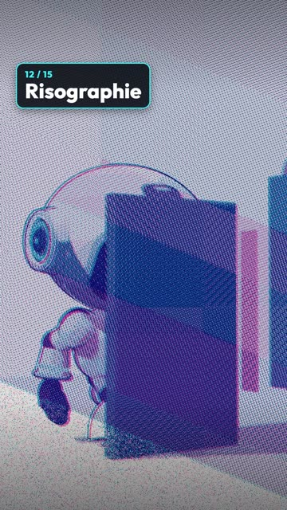

# 05 · Impression & gravure

[← Tous les styles](../README.md#les-110-styles) · 8 styles

- [Risographie](#risographie)
- [Dossier en trame demi-teinte](#dossier-en-trame-demi-teinte)
- [Gravure sur bois](#gravure-sur-bois)
- [Gravure sur cuivre](#gravure-sur-cuivre)
- [Affiche sérigraphiée](#affiche-sérigraphiée)
- [Plan-séquence en gravure](#plan-séquence-en-gravure)
- [Pop art](#pop-art)
- [Collage de gravures anciennes](#collage-de-gravures-anciennes)

## Risographie

**Rendu :** deux à trois encres superposées, trame irrégulière et léger décalage d'impression.



*Exemple : image de notre vidéo, réalisée avec notre pipeline 3D (pas générée par ce prompt).*

**1. Prompt image** (remplace les crochets)

```text
Image verticale 9:16. Style « Risographie » : deux à trois encres superposées, trame irrégulière et léger décalage d'impression.
Sujet : [PERSONNAGE — décris-le en une phrase : silhouette, couleurs, vêtements, signe distinctif], dans [SCÈNE — lieu, moment, lumière].
Moment représenté : juste avant l'action — [PERSONNAGE] aligne deux couches qui deviennent une image.
Composition lisible sur téléphone : personnage entier ou jusqu'aux genoux, mains visibles, silhouette claire, décor et objets originaux, éclairage cohérent avec le style.
À éviter : texte ou lettres générés, logos et marques, personnages existants, membres en trop, visage déformé.
```

**2. Prompt animation** (à partir de l'image obtenue)

```text
À partir de l'image fournie, crée un plan vertical de 3 à 5 secondes dans le style « Risographie » (deux à trois encres superposées, trame irrégulière et léger décalage d'impression).
Action unique et complète : [PERSONNAGE] aligne deux couches qui deviennent une image — avec une préparation du geste, le contact, la conséquence visible et une réaction.
Mouvement : cadence saccadée (8 à 12 images par seconde), couches qui se décalent légèrement.
Caméra : caméra fixe ou glissement latéral.
Garde le même personnage, les mêmes couleurs et les mêmes proportions du début à la fin ; aucun texte, aucun logo.
```

**3. Prompt pour l'animer en code** (Claude Code, ChatGPT, Codex…)

```text
Tu es un développeur d'animation. Avec Remotion (React) ou Three.js, crée une animation verticale 1080×1920 de 5 secondes à 30 i/s dans le style « Risographie » : deux à trois encres superposées, trame irrégulière et léger décalage d'impression.
Personnage : [PERSONNAGE — formes simples à construire en code, couleurs principales]. Scène : [SCÈNE].
Action : [PERSONNAGE] aligne deux couches qui deviennent une image (préparation, geste, conséquence, réaction ; le personnage se déplace et ses membres bougent, pas seulement la caméra).
Mouvement : cadence saccadée (8 à 12 images par seconde), couches qui se décalent légèrement. Caméra : caméra fixe ou glissement latéral.
Contraintes : rendu déterministe (aucun Math.random non initialisé), aucune ressource payante ni téléchargement, pas de texte généré dans l'image, code commenté et une commande pour exporter le MP4.
```

**Mouvement :** cadence saccadée (8 à 12 images par seconde), couches qui se décalent légèrement.  
**Caméra :** caméra fixe ou glissement latéral.  
**Outils :** générateur d'images puis image-vers-vidéo, ou motion design / 3D.  
**Limites :** la trame et le grain varient d'une image à l'autre en vidéo générée : garder la caméra stable.  
**Statut :** prompt préparé, non testé.  
**Référence de style :** [Lemo-Opuscar](https://github.com/lemomo-ai/lemo-opuscar/blob/main/styles/risograph/STYLE.md)

## Dossier en trame demi-teinte

**Rendu :** points d'impression, photos inventées et étiquettes d'archive clairement fictives.

**1. Prompt image** (remplace les crochets)

```text
Image verticale 9:16. Style « Dossier en trame demi-teinte » : points d'impression, photos inventées et étiquettes d'archive clairement fictives.
Sujet : [PERSONNAGE — décris-le en une phrase : silhouette, couleurs, vêtements, signe distinctif], dans [SCÈNE — lieu, moment, lumière].
Moment représenté : juste avant l'action — [PERSONNAGE] ouvre une chemise de dossier illustré.
Composition lisible sur téléphone : personnage entier ou jusqu'aux genoux, mains visibles, silhouette claire, décor et objets originaux, éclairage cohérent avec le style.
À éviter : texte ou lettres générés, logos et marques, personnages existants, membres en trop, visage déformé.
```

**2. Prompt animation** (à partir de l'image obtenue)

```text
À partir de l'image fournie, crée un plan vertical de 3 à 5 secondes dans le style « Dossier en trame demi-teinte » (points d'impression, photos inventées et étiquettes d'archive clairement fictives).
Action unique et complète : [PERSONNAGE] ouvre une chemise de dossier illustré — avec une préparation du geste, le contact, la conséquence visible et une réaction.
Mouvement : cadence saccadée (8 à 12 images par seconde), couches qui se décalent légèrement.
Caméra : caméra fixe ou glissement latéral.
Garde le même personnage, les mêmes couleurs et les mêmes proportions du début à la fin ; aucun texte, aucun logo.
```

**3. Prompt pour l'animer en code** (Claude Code, ChatGPT, Codex…)

```text
Tu es un développeur d'animation. Avec Remotion (React) ou Three.js, crée une animation verticale 1080×1920 de 5 secondes à 30 i/s dans le style « Dossier en trame demi-teinte » : points d'impression, photos inventées et étiquettes d'archive clairement fictives.
Personnage : [PERSONNAGE — formes simples à construire en code, couleurs principales]. Scène : [SCÈNE].
Action : [PERSONNAGE] ouvre une chemise de dossier illustré (préparation, geste, conséquence, réaction ; le personnage se déplace et ses membres bougent, pas seulement la caméra).
Mouvement : cadence saccadée (8 à 12 images par seconde), couches qui se décalent légèrement. Caméra : caméra fixe ou glissement latéral.
Contraintes : rendu déterministe (aucun Math.random non initialisé), aucune ressource payante ni téléchargement, pas de texte généré dans l'image, code commenté et une commande pour exporter le MP4.
```

**Mouvement :** cadence saccadée (8 à 12 images par seconde), couches qui se décalent légèrement.  
**Caméra :** caméra fixe ou glissement latéral.  
**Outils :** générateur d'images puis image-vers-vidéo, ou motion design / 3D.  
**Limites :** la trame et le grain varient d'une image à l'autre en vidéo générée : garder la caméra stable.  
**Statut :** prompt préparé, non testé.  
**Référence de style :** [Lemo-Opuscar](https://github.com/lemomo-ai/lemo-opuscar/blob/main/styles/halftone-dossier/STYLE.md)

## Gravure sur bois

**Rendu :** hachures taillées et contrastes forts entre noir et papier.

**1. Prompt image** (remplace les crochets)

```text
Image verticale 9:16. Style « Gravure sur bois » : hachures taillées et contrastes forts entre noir et papier.
Sujet : [PERSONNAGE — décris-le en une phrase : silhouette, couleurs, vêtements, signe distinctif], dans [SCÈNE — lieu, moment, lumière].
Moment représenté : juste avant l'action — [PERSONNAGE] taille un sillon et un paysage émerge.
Composition lisible sur téléphone : personnage entier ou jusqu'aux genoux, mains visibles, silhouette claire, décor et objets originaux, éclairage cohérent avec le style.
À éviter : texte ou lettres générés, logos et marques, personnages existants, membres en trop, visage déformé.
```

**2. Prompt animation** (à partir de l'image obtenue)

```text
À partir de l'image fournie, crée un plan vertical de 3 à 5 secondes dans le style « Gravure sur bois » (hachures taillées et contrastes forts entre noir et papier).
Action unique et complète : [PERSONNAGE] taille un sillon et un paysage émerge — avec une préparation du geste, le contact, la conséquence visible et une réaction.
Mouvement : cadence saccadée (8 à 12 images par seconde), couches qui se décalent légèrement.
Caméra : caméra fixe ou glissement latéral.
Garde le même personnage, les mêmes couleurs et les mêmes proportions du début à la fin ; aucun texte, aucun logo.
```

**3. Prompt pour l'animer en code** (Claude Code, ChatGPT, Codex…)

```text
Tu es un développeur d'animation. Avec Remotion (React) ou Three.js, crée une animation verticale 1080×1920 de 5 secondes à 30 i/s dans le style « Gravure sur bois » : hachures taillées et contrastes forts entre noir et papier.
Personnage : [PERSONNAGE — formes simples à construire en code, couleurs principales]. Scène : [SCÈNE].
Action : [PERSONNAGE] taille un sillon et un paysage émerge (préparation, geste, conséquence, réaction ; le personnage se déplace et ses membres bougent, pas seulement la caméra).
Mouvement : cadence saccadée (8 à 12 images par seconde), couches qui se décalent légèrement. Caméra : caméra fixe ou glissement latéral.
Contraintes : rendu déterministe (aucun Math.random non initialisé), aucune ressource payante ni téléchargement, pas de texte généré dans l'image, code commenté et une commande pour exporter le MP4.
```

**Mouvement :** cadence saccadée (8 à 12 images par seconde), couches qui se décalent légèrement.  
**Caméra :** caméra fixe ou glissement latéral.  
**Outils :** générateur d'images puis image-vers-vidéo, ou motion design / 3D.  
**Limites :** la trame et le grain varient d'une image à l'autre en vidéo générée : garder la caméra stable.  
**Statut :** prompt préparé, non testé.  
**Référence de style :** [Lemo-Opuscar](https://github.com/lemomo-ai/lemo-opuscar/blob/main/styles/woodcut/STYLE.md)

## Gravure sur cuivre

**Rendu :** hachures fines croisées et ombres gravées, détails métalliques.

**1. Prompt image** (remplace les crochets)

```text
Image verticale 9:16. Style « Gravure sur cuivre » : hachures fines croisées et ombres gravées, détails métalliques.
Sujet : [PERSONNAGE — décris-le en une phrase : silhouette, couleurs, vêtements, signe distinctif], dans [SCÈNE — lieu, moment, lumière].
Moment représenté : juste avant l'action — [PERSONNAGE] fait rouler une presse qui révèle son portrait.
Composition lisible sur téléphone : personnage entier ou jusqu'aux genoux, mains visibles, silhouette claire, décor et objets originaux, éclairage cohérent avec le style.
À éviter : texte ou lettres générés, logos et marques, personnages existants, membres en trop, visage déformé.
```

**2. Prompt animation** (à partir de l'image obtenue)

```text
À partir de l'image fournie, crée un plan vertical de 3 à 5 secondes dans le style « Gravure sur cuivre » (hachures fines croisées et ombres gravées, détails métalliques).
Action unique et complète : [PERSONNAGE] fait rouler une presse qui révèle son portrait — avec une préparation du geste, le contact, la conséquence visible et une réaction.
Mouvement : cadence saccadée (8 à 12 images par seconde), couches qui se décalent légèrement.
Caméra : caméra fixe ou glissement latéral.
Garde le même personnage, les mêmes couleurs et les mêmes proportions du début à la fin ; aucun texte, aucun logo.
```

**3. Prompt pour l'animer en code** (Claude Code, ChatGPT, Codex…)

```text
Tu es un développeur d'animation. Avec Remotion (React) ou Three.js, crée une animation verticale 1080×1920 de 5 secondes à 30 i/s dans le style « Gravure sur cuivre » : hachures fines croisées et ombres gravées, détails métalliques.
Personnage : [PERSONNAGE — formes simples à construire en code, couleurs principales]. Scène : [SCÈNE].
Action : [PERSONNAGE] fait rouler une presse qui révèle son portrait (préparation, geste, conséquence, réaction ; le personnage se déplace et ses membres bougent, pas seulement la caméra).
Mouvement : cadence saccadée (8 à 12 images par seconde), couches qui se décalent légèrement. Caméra : caméra fixe ou glissement latéral.
Contraintes : rendu déterministe (aucun Math.random non initialisé), aucune ressource payante ni téléchargement, pas de texte généré dans l'image, code commenté et une commande pour exporter le MP4.
```

**Mouvement :** cadence saccadée (8 à 12 images par seconde), couches qui se décalent légèrement.  
**Caméra :** caméra fixe ou glissement latéral.  
**Outils :** générateur d'images puis image-vers-vidéo, ou motion design / 3D.  
**Limites :** la trame et le grain varient d'une image à l'autre en vidéo générée : garder la caméra stable.  
**Statut :** prompt préparé, non testé.  
**Référence de style :** [Lemo-Opuscar](https://github.com/lemomo-ai/lemo-opuscar/blob/main/styles/engraving/STYLE.md)

## Affiche sérigraphiée

**Rendu :** aplats limités, grain d'encre et formes d'affiche audacieuses.

**1. Prompt image** (remplace les crochets)

```text
Image verticale 9:16. Style « Affiche sérigraphiée » : aplats limités, grain d'encre et formes d'affiche audacieuses.
Sujet : [PERSONNAGE — décris-le en une phrase : silhouette, couleurs, vêtements, signe distinctif], dans [SCÈNE — lieu, moment, lumière].
Moment représenté : juste avant l'action — [PERSONNAGE] tire une feuille sous un cadre de sérigraphie.
Composition lisible sur téléphone : personnage entier ou jusqu'aux genoux, mains visibles, silhouette claire, décor et objets originaux, éclairage cohérent avec le style.
À éviter : texte ou lettres générés, logos et marques, personnages existants, membres en trop, visage déformé.
```

**2. Prompt animation** (à partir de l'image obtenue)

```text
À partir de l'image fournie, crée un plan vertical de 3 à 5 secondes dans le style « Affiche sérigraphiée » (aplats limités, grain d'encre et formes d'affiche audacieuses).
Action unique et complète : [PERSONNAGE] tire une feuille sous un cadre de sérigraphie — avec une préparation du geste, le contact, la conséquence visible et une réaction.
Mouvement : cadence saccadée (8 à 12 images par seconde), couches qui se décalent légèrement.
Caméra : caméra fixe ou glissement latéral.
Garde le même personnage, les mêmes couleurs et les mêmes proportions du début à la fin ; aucun texte, aucun logo.
```

**3. Prompt pour l'animer en code** (Claude Code, ChatGPT, Codex…)

```text
Tu es un développeur d'animation. Avec Remotion (React) ou Three.js, crée une animation verticale 1080×1920 de 5 secondes à 30 i/s dans le style « Affiche sérigraphiée » : aplats limités, grain d'encre et formes d'affiche audacieuses.
Personnage : [PERSONNAGE — formes simples à construire en code, couleurs principales]. Scène : [SCÈNE].
Action : [PERSONNAGE] tire une feuille sous un cadre de sérigraphie (préparation, geste, conséquence, réaction ; le personnage se déplace et ses membres bougent, pas seulement la caméra).
Mouvement : cadence saccadée (8 à 12 images par seconde), couches qui se décalent légèrement. Caméra : caméra fixe ou glissement latéral.
Contraintes : rendu déterministe (aucun Math.random non initialisé), aucune ressource payante ni téléchargement, pas de texte généré dans l'image, code commenté et une commande pour exporter le MP4.
```

**Mouvement :** cadence saccadée (8 à 12 images par seconde), couches qui se décalent légèrement.  
**Caméra :** caméra fixe ou glissement latéral.  
**Outils :** générateur d'images puis image-vers-vidéo, ou motion design / 3D.  
**Limites :** la trame et le grain varient d'une image à l'autre en vidéo générée : garder la caméra stable.  
**Statut :** prompt préparé, non testé.  
**Référence de style :** [Lemo-Opuscar](https://github.com/lemomo-ai/lemo-opuscar/blob/main/styles/silkscreen-poster/STYLE.md)

## Plan-séquence en gravure

**Rendu :** gravure évoluant dans le cadre avec morphing contrôlé des traits.

**1. Prompt image** (remplace les crochets)

```text
Image verticale 9:16. Style « Plan-séquence en gravure » : gravure évoluant dans le cadre avec morphing contrôlé des traits.
Sujet : [PERSONNAGE — décris-le en une phrase : silhouette, couleurs, vêtements, signe distinctif], dans [SCÈNE — lieu, moment, lumière].
Moment représenté : juste avant l'action — [PERSONNAGE] marche tandis que toute la gravure se redessine autour de lui.
Composition lisible sur téléphone : personnage entier ou jusqu'aux genoux, mains visibles, silhouette claire, décor et objets originaux, éclairage cohérent avec le style.
À éviter : texte ou lettres générés, logos et marques, personnages existants, membres en trop, visage déformé.
```

**2. Prompt animation** (à partir de l'image obtenue)

```text
À partir de l'image fournie, crée un plan vertical de 3 à 5 secondes dans le style « Plan-séquence en gravure » (gravure évoluant dans le cadre avec morphing contrôlé des traits).
Action unique et complète : [PERSONNAGE] marche tandis que toute la gravure se redessine autour de lui — avec une préparation du geste, le contact, la conséquence visible et une réaction.
Mouvement : cadence saccadée (8 à 12 images par seconde), couches qui se décalent légèrement.
Caméra : caméra fixe ou glissement latéral.
Garde le même personnage, les mêmes couleurs et les mêmes proportions du début à la fin ; aucun texte, aucun logo.
```

**3. Prompt pour l'animer en code** (Claude Code, ChatGPT, Codex…)

```text
Tu es un développeur d'animation. Avec Remotion (React) ou Three.js, crée une animation verticale 1080×1920 de 5 secondes à 30 i/s dans le style « Plan-séquence en gravure » : gravure évoluant dans le cadre avec morphing contrôlé des traits.
Personnage : [PERSONNAGE — formes simples à construire en code, couleurs principales]. Scène : [SCÈNE].
Action : [PERSONNAGE] marche tandis que toute la gravure se redessine autour de lui (préparation, geste, conséquence, réaction ; le personnage se déplace et ses membres bougent, pas seulement la caméra).
Mouvement : cadence saccadée (8 à 12 images par seconde), couches qui se décalent légèrement. Caméra : caméra fixe ou glissement latéral.
Contraintes : rendu déterministe (aucun Math.random non initialisé), aucune ressource payante ni téléchargement, pas de texte généré dans l'image, code commenté et une commande pour exporter le MP4.
```

**Mouvement :** cadence saccadée (8 à 12 images par seconde), couches qui se décalent légèrement.  
**Caméra :** caméra fixe ou glissement latéral.  
**Outils :** générateur d'images puis image-vers-vidéo, ou motion design / 3D.  
**Limites :** la trame et le grain varient d'une image à l'autre en vidéo générée : garder la caméra stable.  
**Statut :** prompt préparé, non testé.  
**Référence de style :** [Lemo-Opuscar](https://github.com/lemomo-ai/lemo-opuscar/blob/main/styles/printed-long-take/STYLE.md)

## Pop art

**Rendu :** contraste saturé, répétitions graphiques et bulles d'impact abstraites.

**1. Prompt image** (remplace les crochets)

```text
Image verticale 9:16. Style « Pop art » : contraste saturé, répétitions graphiques et bulles d'impact abstraites.
Sujet : [PERSONNAGE — décris-le en une phrase : silhouette, couleurs, vêtements, signe distinctif], dans [SCÈNE — lieu, moment, lumière].
Moment représenté : juste avant l'action — [PERSONNAGE] multiplie une icône en quatre cases colorées.
Composition lisible sur téléphone : personnage entier ou jusqu'aux genoux, mains visibles, silhouette claire, décor et objets originaux, éclairage cohérent avec le style.
À éviter : texte ou lettres générés, logos et marques, personnages existants, membres en trop, visage déformé.
```

**2. Prompt animation** (à partir de l'image obtenue)

```text
À partir de l'image fournie, crée un plan vertical de 3 à 5 secondes dans le style « Pop art » (contraste saturé, répétitions graphiques et bulles d'impact abstraites).
Action unique et complète : [PERSONNAGE] multiplie une icône en quatre cases colorées — avec une préparation du geste, le contact, la conséquence visible et une réaction.
Mouvement : cadence saccadée (8 à 12 images par seconde), couches qui se décalent légèrement.
Caméra : caméra fixe ou glissement latéral.
Garde le même personnage, les mêmes couleurs et les mêmes proportions du début à la fin ; aucun texte, aucun logo.
```

**3. Prompt pour l'animer en code** (Claude Code, ChatGPT, Codex…)

```text
Tu es un développeur d'animation. Avec Remotion (React) ou Three.js, crée une animation verticale 1080×1920 de 5 secondes à 30 i/s dans le style « Pop art » : contraste saturé, répétitions graphiques et bulles d'impact abstraites.
Personnage : [PERSONNAGE — formes simples à construire en code, couleurs principales]. Scène : [SCÈNE].
Action : [PERSONNAGE] multiplie une icône en quatre cases colorées (préparation, geste, conséquence, réaction ; le personnage se déplace et ses membres bougent, pas seulement la caméra).
Mouvement : cadence saccadée (8 à 12 images par seconde), couches qui se décalent légèrement. Caméra : caméra fixe ou glissement latéral.
Contraintes : rendu déterministe (aucun Math.random non initialisé), aucune ressource payante ni téléchargement, pas de texte généré dans l'image, code commenté et une commande pour exporter le MP4.
```

**Mouvement :** cadence saccadée (8 à 12 images par seconde), couches qui se décalent légèrement.  
**Caméra :** caméra fixe ou glissement latéral.  
**Outils :** générateur d'images puis image-vers-vidéo, ou motion design / 3D.  
**Limites :** la trame et le grain varient d'une image à l'autre en vidéo générée : garder la caméra stable.  
**Statut :** prompt préparé, non testé.  
**Référence de style :** [Lemo-Opuscar](https://github.com/lemomo-ai/lemo-opuscar/blob/main/styles/pop-art/STYLE.md)

## Collage de gravures anciennes

**Rendu :** gravures juxtaposées, bordures déchirées et textures de vieux papier.

**1. Prompt image** (remplace les crochets)

```text
Image verticale 9:16. Style « Collage de gravures anciennes » : gravures juxtaposées, bordures déchirées et textures de vieux papier.
Sujet : [PERSONNAGE — décris-le en une phrase : silhouette, couleurs, vêtements, signe distinctif], dans [SCÈNE — lieu, moment, lumière].
Moment représenté : juste avant l'action — [PERSONNAGE] décolle une couche de papier et découvre l'image suivante.
Composition lisible sur téléphone : personnage entier ou jusqu'aux genoux, mains visibles, silhouette claire, décor et objets originaux, éclairage cohérent avec le style.
À éviter : texte ou lettres générés, logos et marques, personnages existants, membres en trop, visage déformé.
```

**2. Prompt animation** (à partir de l'image obtenue)

```text
À partir de l'image fournie, crée un plan vertical de 3 à 5 secondes dans le style « Collage de gravures anciennes » (gravures juxtaposées, bordures déchirées et textures de vieux papier).
Action unique et complète : [PERSONNAGE] décolle une couche de papier et découvre l'image suivante — avec une préparation du geste, le contact, la conséquence visible et une réaction.
Mouvement : cadence saccadée (8 à 12 images par seconde), couches qui se décalent légèrement.
Caméra : caméra fixe ou glissement latéral.
Garde le même personnage, les mêmes couleurs et les mêmes proportions du début à la fin ; aucun texte, aucun logo.
```

**3. Prompt pour l'animer en code** (Claude Code, ChatGPT, Codex…)

```text
Tu es un développeur d'animation. Avec Remotion (React) ou Three.js, crée une animation verticale 1080×1920 de 5 secondes à 30 i/s dans le style « Collage de gravures anciennes » : gravures juxtaposées, bordures déchirées et textures de vieux papier.
Personnage : [PERSONNAGE — formes simples à construire en code, couleurs principales]. Scène : [SCÈNE].
Action : [PERSONNAGE] décolle une couche de papier et découvre l'image suivante (préparation, geste, conséquence, réaction ; le personnage se déplace et ses membres bougent, pas seulement la caméra).
Mouvement : cadence saccadée (8 à 12 images par seconde), couches qui se décalent légèrement. Caméra : caméra fixe ou glissement latéral.
Contraintes : rendu déterministe (aucun Math.random non initialisé), aucune ressource payante ni téléchargement, pas de texte généré dans l'image, code commenté et une commande pour exporter le MP4.
```

**Mouvement :** cadence saccadée (8 à 12 images par seconde), couches qui se décalent légèrement.  
**Caméra :** caméra fixe ou glissement latéral.  
**Outils :** générateur d'images puis image-vers-vidéo, ou motion design / 3D.  
**Limites :** la trame et le grain varient d'une image à l'autre en vidéo générée : garder la caméra stable.  
**Statut :** prompt préparé, non testé.  
**Référence de style :** [Lemo-Opuscar](https://github.com/lemomo-ai/lemo-opuscar/blob/main/styles/vintage-collage/STYLE.md)

