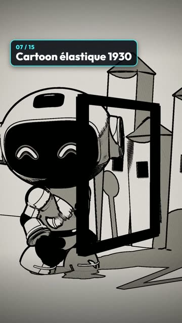
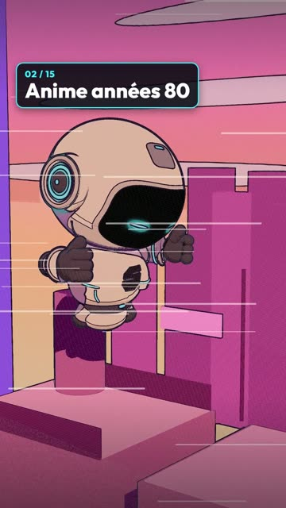
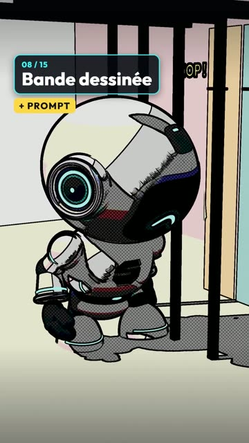

# 08 · Dessins animés

[← Tous les styles](../README.md#les-110-styles) · 6 styles

- [Cartoon élastique années 1930](#cartoon-élastique-années-1930)
- [Anime sur celluloïd années 1980](#anime-sur-celluloïd-années-1980)
- [Cartoon science-fiction](#cartoon-science-fiction)
- [Cartoon moderniste années 1950](#cartoon-moderniste-années-1950)
- [Cartoon historique illustré](#cartoon-historique-illustré)
- [Cases manga](#cases-manga)

## Cartoon élastique années 1930

**Rendu :** membres extensibles, rebond exagéré, noir et blanc et grain de film.



*Exemple : image de notre vidéo, réalisée avec notre pipeline 3D (pas générée par ce prompt).*

**1. Prompt image** (remplace les crochets)

```text
Image verticale 9:16. Style « Cartoon élastique années 1930 » : membres extensibles, rebond exagéré, noir et blanc et grain de film.
Sujet : [PERSONNAGE — décris-le en une phrase : silhouette, couleurs, vêtements, signe distinctif], dans [SCÈNE — lieu, moment, lumière].
Moment représenté : juste avant l'action — [PERSONNAGE] court, s'étire puis reprend sa forme.
Composition lisible sur téléphone : personnage entier ou jusqu'aux genoux, mains visibles, silhouette claire, décor et objets originaux, éclairage cohérent avec le style.
À éviter : texte ou lettres générés, logos et marques, personnages existants, membres en trop, visage déformé.
```

**2. Prompt animation** (à partir de l'image obtenue)

```text
À partir de l'image fournie, crée un plan vertical de 3 à 5 secondes dans le style « Cartoon élastique années 1930 » (membres extensibles, rebond exagéré, noir et blanc et grain de film).
Action unique et complète : [PERSONNAGE] court, s'étire puis reprend sa forme — avec une préparation du geste, le contact, la conséquence visible et une réaction.
Mouvement : anticipation, étirement et écrasement, poses claires, animé « en 2 » (12 poses par seconde).
Caméra : plans de suivi et changements d'axe nets.
Garde le même personnage, les mêmes couleurs et les mêmes proportions du début à la fin ; aucun texte, aucun logo.
```

**3. Prompt pour l'animer en code** (Claude Code, ChatGPT, Codex…)

```text
Tu es un développeur d'animation. Avec Remotion (React) ou Three.js, crée une animation verticale 1080×1920 de 5 secondes à 30 i/s dans le style « Cartoon élastique années 1930 » : membres extensibles, rebond exagéré, noir et blanc et grain de film.
Personnage : [PERSONNAGE — formes simples à construire en code, couleurs principales]. Scène : [SCÈNE].
Action : [PERSONNAGE] court, s'étire puis reprend sa forme (préparation, geste, conséquence, réaction ; le personnage se déplace et ses membres bougent, pas seulement la caméra).
Mouvement : anticipation, étirement et écrasement, poses claires, animé « en 2 » (12 poses par seconde). Caméra : plans de suivi et changements d'axe nets.
Contraintes : rendu déterministe (aucun Math.random non initialisé), aucune ressource payante ni téléchargement, pas de texte généré dans l'image, code commenté et une commande pour exporter le MP4.
```

**Mouvement :** anticipation, étirement et écrasement, poses claires, animé « en 2 » (12 poses par seconde).  
**Caméra :** plans de suivi et changements d'axe nets.  
**Outils :** générateur d'images puis image-vers-vidéo, ou motion design / 3D.  
**Limites :** garder le même personnage d'un plan à l'autre : réutiliser la même image de référence.  
**Statut :** prompt préparé, non testé.  
**Référence de style :** [Lemo-Opuscar](https://github.com/lemomo-ai/lemo-opuscar/blob/main/styles/rubber-hose/STYLE.md)

## Anime sur celluloïd années 1980

**Rendu :** ombres franches, arrière-plan peint et mouvement sur poses-clés.



*Exemple : image de notre vidéo, réalisée avec notre pipeline 3D (pas générée par ce prompt).*

**1. Prompt image** (remplace les crochets)

```text
Image verticale 9:16. Style « Anime sur celluloïd années 1980 » : ombres franches, arrière-plan peint et mouvement sur poses-clés.
Sujet : [PERSONNAGE — décris-le en une phrase : silhouette, couleurs, vêtements, signe distinctif], dans [SCÈNE — lieu, moment, lumière].
Moment représenté : juste avant l'action — [PERSONNAGE] saute sur un toit néon et pivote en contrechamp.
Composition lisible sur téléphone : personnage entier ou jusqu'aux genoux, mains visibles, silhouette claire, décor et objets originaux, éclairage cohérent avec le style.
À éviter : texte ou lettres générés, logos et marques, personnages existants, membres en trop, visage déformé.
```

**2. Prompt animation** (à partir de l'image obtenue)

```text
À partir de l'image fournie, crée un plan vertical de 3 à 5 secondes dans le style « Anime sur celluloïd années 1980 » (ombres franches, arrière-plan peint et mouvement sur poses-clés).
Action unique et complète : [PERSONNAGE] saute sur un toit néon et pivote en contrechamp — avec une préparation du geste, le contact, la conséquence visible et une réaction.
Mouvement : anticipation, étirement et écrasement, poses claires, animé « en 2 » (12 poses par seconde).
Caméra : plans de suivi et changements d'axe nets.
Garde le même personnage, les mêmes couleurs et les mêmes proportions du début à la fin ; aucun texte, aucun logo.
```

**3. Prompt pour l'animer en code** (Claude Code, ChatGPT, Codex…)

```text
Tu es un développeur d'animation. Avec Remotion (React) ou Three.js, crée une animation verticale 1080×1920 de 5 secondes à 30 i/s dans le style « Anime sur celluloïd années 1980 » : ombres franches, arrière-plan peint et mouvement sur poses-clés.
Personnage : [PERSONNAGE — formes simples à construire en code, couleurs principales]. Scène : [SCÈNE].
Action : [PERSONNAGE] saute sur un toit néon et pivote en contrechamp (préparation, geste, conséquence, réaction ; le personnage se déplace et ses membres bougent, pas seulement la caméra).
Mouvement : anticipation, étirement et écrasement, poses claires, animé « en 2 » (12 poses par seconde). Caméra : plans de suivi et changements d'axe nets.
Contraintes : rendu déterministe (aucun Math.random non initialisé), aucune ressource payante ni téléchargement, pas de texte généré dans l'image, code commenté et une commande pour exporter le MP4.
```

**Mouvement :** anticipation, étirement et écrasement, poses claires, animé « en 2 » (12 poses par seconde).  
**Caméra :** plans de suivi et changements d'axe nets.  
**Outils :** générateur d'images puis image-vers-vidéo, ou motion design / 3D.  
**Limites :** garder le même personnage d'un plan à l'autre : réutiliser la même image de référence.  
**Statut :** prompt préparé, non testé.  
**Référence de style :** [Lemo-Opuscar](https://github.com/lemomo-ai/lemo-opuscar/blob/main/styles/cel-anime-80s/STYLE.md)

## Cartoon science-fiction

**Rendu :** aplats francs, trait expressif et décor de science-fiction original.

**1. Prompt image** (remplace les crochets)

```text
Image verticale 9:16. Style « Cartoon science-fiction » : aplats francs, trait expressif et décor de science-fiction original.
Sujet : [PERSONNAGE — décris-le en une phrase : silhouette, couleurs, vêtements, signe distinctif], dans [SCÈNE — lieu, moment, lumière].
Moment représenté : juste avant l'action — [PERSONNAGE] ouvre un portail puis réagit en gros plan.
Composition lisible sur téléphone : personnage entier ou jusqu'aux genoux, mains visibles, silhouette claire, décor et objets originaux, éclairage cohérent avec le style.
À éviter : texte ou lettres générés, logos et marques, personnages existants, membres en trop, visage déformé.
```

**2. Prompt animation** (à partir de l'image obtenue)

```text
À partir de l'image fournie, crée un plan vertical de 3 à 5 secondes dans le style « Cartoon science-fiction » (aplats francs, trait expressif et décor de science-fiction original).
Action unique et complète : [PERSONNAGE] ouvre un portail puis réagit en gros plan — avec une préparation du geste, le contact, la conséquence visible et une réaction.
Mouvement : anticipation, étirement et écrasement, poses claires, animé « en 2 » (12 poses par seconde).
Caméra : plans de suivi et changements d'axe nets.
Garde le même personnage, les mêmes couleurs et les mêmes proportions du début à la fin ; aucun texte, aucun logo.
```

**3. Prompt pour l'animer en code** (Claude Code, ChatGPT, Codex…)

```text
Tu es un développeur d'animation. Avec Remotion (React) ou Three.js, crée une animation verticale 1080×1920 de 5 secondes à 30 i/s dans le style « Cartoon science-fiction » : aplats francs, trait expressif et décor de science-fiction original.
Personnage : [PERSONNAGE — formes simples à construire en code, couleurs principales]. Scène : [SCÈNE].
Action : [PERSONNAGE] ouvre un portail puis réagit en gros plan (préparation, geste, conséquence, réaction ; le personnage se déplace et ses membres bougent, pas seulement la caméra).
Mouvement : anticipation, étirement et écrasement, poses claires, animé « en 2 » (12 poses par seconde). Caméra : plans de suivi et changements d'axe nets.
Contraintes : rendu déterministe (aucun Math.random non initialisé), aucune ressource payante ni téléchargement, pas de texte généré dans l'image, code commenté et une commande pour exporter le MP4.
```

**Mouvement :** anticipation, étirement et écrasement, poses claires, animé « en 2 » (12 poses par seconde).  
**Caméra :** plans de suivi et changements d'axe nets.  
**Outils :** générateur d'images puis image-vers-vidéo, ou motion design / 3D.  
**Limites :** garder le même personnage d'un plan à l'autre : réutiliser la même image de référence.  
**Statut :** prompt préparé, non testé.  
**Référence de style :** [Lemo-Opuscar](https://github.com/lemomo-ai/lemo-opuscar/blob/main/styles/scifi-toon/STYLE.md)

## Cartoon moderniste années 1950

**Rendu :** formes simplifiées anguleuses, compositions rétro et palettes chaleureuses.

**1. Prompt image** (remplace les crochets)

```text
Image verticale 9:16. Style « Cartoon moderniste années 1950 » : formes simplifiées anguleuses, compositions rétro et palettes chaleureuses.
Sujet : [PERSONNAGE — décris-le en une phrase : silhouette, couleurs, vêtements, signe distinctif], dans [SCÈNE — lieu, moment, lumière].
Moment représenté : juste avant l'action — [PERSONNAGE] entre dans un salon rétro et tire une chaise.
Composition lisible sur téléphone : personnage entier ou jusqu'aux genoux, mains visibles, silhouette claire, décor et objets originaux, éclairage cohérent avec le style.
À éviter : texte ou lettres générés, logos et marques, personnages existants, membres en trop, visage déformé.
```

**2. Prompt animation** (à partir de l'image obtenue)

```text
À partir de l'image fournie, crée un plan vertical de 3 à 5 secondes dans le style « Cartoon moderniste années 1950 » (formes simplifiées anguleuses, compositions rétro et palettes chaleureuses).
Action unique et complète : [PERSONNAGE] entre dans un salon rétro et tire une chaise — avec une préparation du geste, le contact, la conséquence visible et une réaction.
Mouvement : anticipation, étirement et écrasement, poses claires, animé « en 2 » (12 poses par seconde).
Caméra : plans de suivi et changements d'axe nets.
Garde le même personnage, les mêmes couleurs et les mêmes proportions du début à la fin ; aucun texte, aucun logo.
```

**3. Prompt pour l'animer en code** (Claude Code, ChatGPT, Codex…)

```text
Tu es un développeur d'animation. Avec Remotion (React) ou Three.js, crée une animation verticale 1080×1920 de 5 secondes à 30 i/s dans le style « Cartoon moderniste années 1950 » : formes simplifiées anguleuses, compositions rétro et palettes chaleureuses.
Personnage : [PERSONNAGE — formes simples à construire en code, couleurs principales]. Scène : [SCÈNE].
Action : [PERSONNAGE] entre dans un salon rétro et tire une chaise (préparation, geste, conséquence, réaction ; le personnage se déplace et ses membres bougent, pas seulement la caméra).
Mouvement : anticipation, étirement et écrasement, poses claires, animé « en 2 » (12 poses par seconde). Caméra : plans de suivi et changements d'axe nets.
Contraintes : rendu déterministe (aucun Math.random non initialisé), aucune ressource payante ni téléchargement, pas de texte généré dans l'image, code commenté et une commande pour exporter le MP4.
```

**Mouvement :** anticipation, étirement et écrasement, poses claires, animé « en 2 » (12 poses par seconde).  
**Caméra :** plans de suivi et changements d'axe nets.  
**Outils :** générateur d'images puis image-vers-vidéo, ou motion design / 3D.  
**Limites :** garder le même personnage d'un plan à l'autre : réutiliser la même image de référence.  
**Statut :** prompt préparé, non testé.  
**Référence de style :** [Lemo-Opuscar](https://github.com/lemomo-ai/lemo-opuscar/blob/main/styles/midcentury-toon/STYLE.md)

## Cartoon historique illustré

**Rendu :** images dessinées, cases narratives et repères temporels fictifs lisibles.

**1. Prompt image** (remplace les crochets)

```text
Image verticale 9:16. Style « Cartoon historique illustré » : images dessinées, cases narratives et repères temporels fictifs lisibles.
Sujet : [PERSONNAGE — décris-le en une phrase : silhouette, couleurs, vêtements, signe distinctif], dans [SCÈNE — lieu, moment, lumière].
Moment représenté : juste avant l'action — [PERSONNAGE] feuillette une mini-frise inventée.
Composition lisible sur téléphone : personnage entier ou jusqu'aux genoux, mains visibles, silhouette claire, décor et objets originaux, éclairage cohérent avec le style.
À éviter : texte ou lettres générés, logos et marques, personnages existants, membres en trop, visage déformé.
```

**2. Prompt animation** (à partir de l'image obtenue)

```text
À partir de l'image fournie, crée un plan vertical de 3 à 5 secondes dans le style « Cartoon historique illustré » (images dessinées, cases narratives et repères temporels fictifs lisibles).
Action unique et complète : [PERSONNAGE] feuillette une mini-frise inventée — avec une préparation du geste, le contact, la conséquence visible et une réaction.
Mouvement : anticipation, étirement et écrasement, poses claires, animé « en 2 » (12 poses par seconde).
Caméra : plans de suivi et changements d'axe nets.
Garde le même personnage, les mêmes couleurs et les mêmes proportions du début à la fin ; aucun texte, aucun logo.
```

**3. Prompt pour l'animer en code** (Claude Code, ChatGPT, Codex…)

```text
Tu es un développeur d'animation. Avec Remotion (React) ou Three.js, crée une animation verticale 1080×1920 de 5 secondes à 30 i/s dans le style « Cartoon historique illustré » : images dessinées, cases narratives et repères temporels fictifs lisibles.
Personnage : [PERSONNAGE — formes simples à construire en code, couleurs principales]. Scène : [SCÈNE].
Action : [PERSONNAGE] feuillette une mini-frise inventée (préparation, geste, conséquence, réaction ; le personnage se déplace et ses membres bougent, pas seulement la caméra).
Mouvement : anticipation, étirement et écrasement, poses claires, animé « en 2 » (12 poses par seconde). Caméra : plans de suivi et changements d'axe nets.
Contraintes : rendu déterministe (aucun Math.random non initialisé), aucune ressource payante ni téléchargement, pas de texte généré dans l'image, code commenté et une commande pour exporter le MP4.
```

**Mouvement :** anticipation, étirement et écrasement, poses claires, animé « en 2 » (12 poses par seconde).  
**Caméra :** plans de suivi et changements d'axe nets.  
**Outils :** générateur d'images puis image-vers-vidéo, ou motion design / 3D.  
**Limites :** garder le même personnage d'un plan à l'autre : réutiliser la même image de référence.  
**Statut :** prompt préparé, non testé.  
**Référence de style :** [Lemo-Opuscar](https://github.com/lemomo-ai/lemo-opuscar/blob/main/styles/comic-history/STYLE.md)

## Cases manga

**Rendu :** noir et blanc très contrasté, trames et composition de planches.



*Exemple : image de notre vidéo, réalisée avec notre pipeline 3D (pas générée par ce prompt).*

**1. Prompt image** (remplace les crochets)

```text
Image verticale 9:16. Style « Cases manga » : noir et blanc très contrasté, trames et composition de planches.
Sujet : [PERSONNAGE — décris-le en une phrase : silhouette, couleurs, vêtements, signe distinctif], dans [SCÈNE — lieu, moment, lumière].
Moment représenté : juste avant l'action — [PERSONNAGE] bondit hors d'une case vers la suivante.
Composition lisible sur téléphone : personnage entier ou jusqu'aux genoux, mains visibles, silhouette claire, décor et objets originaux, éclairage cohérent avec le style.
À éviter : texte ou lettres générés, logos et marques, personnages existants, membres en trop, visage déformé.
```

**2. Prompt animation** (à partir de l'image obtenue)

```text
À partir de l'image fournie, crée un plan vertical de 3 à 5 secondes dans le style « Cases manga » (noir et blanc très contrasté, trames et composition de planches).
Action unique et complète : [PERSONNAGE] bondit hors d'une case vers la suivante — avec une préparation du geste, le contact, la conséquence visible et une réaction.
Mouvement : anticipation, étirement et écrasement, poses claires, animé « en 2 » (12 poses par seconde).
Caméra : plans de suivi et changements d'axe nets.
Garde le même personnage, les mêmes couleurs et les mêmes proportions du début à la fin ; aucun texte, aucun logo.
```

**3. Prompt pour l'animer en code** (Claude Code, ChatGPT, Codex…)

```text
Tu es un développeur d'animation. Avec Remotion (React) ou Three.js, crée une animation verticale 1080×1920 de 5 secondes à 30 i/s dans le style « Cases manga » : noir et blanc très contrasté, trames et composition de planches.
Personnage : [PERSONNAGE — formes simples à construire en code, couleurs principales]. Scène : [SCÈNE].
Action : [PERSONNAGE] bondit hors d'une case vers la suivante (préparation, geste, conséquence, réaction ; le personnage se déplace et ses membres bougent, pas seulement la caméra).
Mouvement : anticipation, étirement et écrasement, poses claires, animé « en 2 » (12 poses par seconde). Caméra : plans de suivi et changements d'axe nets.
Contraintes : rendu déterministe (aucun Math.random non initialisé), aucune ressource payante ni téléchargement, pas de texte généré dans l'image, code commenté et une commande pour exporter le MP4.
```

**Mouvement :** anticipation, étirement et écrasement, poses claires, animé « en 2 » (12 poses par seconde).  
**Caméra :** plans de suivi et changements d'axe nets.  
**Outils :** générateur d'images puis image-vers-vidéo, ou motion design / 3D.  
**Limites :** garder le même personnage d'un plan à l'autre : réutiliser la même image de référence.  
**Statut :** prompt préparé, non testé.  
**Référence de style :** [Lemo-Opuscar](https://github.com/lemomo-ai/lemo-opuscar/blob/main/styles/manga-panels/STYLE.md)

