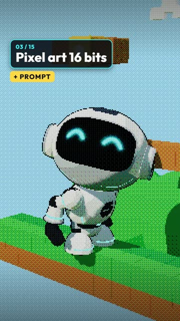

# 09 · Jeux vidéo

[← Tous les styles](../README.md#les-110-styles) · 4 styles

- [RPG pixel 16 bits](#rpg-pixel-16-bits)
- [Pixel art en profondeur 2,5D](#pixel-art-en-profondeur-25d)
- [Microjeu ultra-court](#microjeu-ultra-court)
- [Jeu de rythme télévisé](#jeu-de-rythme-télévisé)

## RPG pixel 16 bits

**Rendu :** pixels nets, palette limitée, sprites animés par étapes et menus rétro.



*Exemple : image de notre vidéo, réalisée avec notre pipeline 3D (pas générée par ce prompt).*

**1. Prompt image** (remplace les crochets)

```text
Image verticale 9:16. Style « RPG pixel 16 bits » : pixels nets, palette limitée, sprites animés par étapes et menus rétro.
Sujet : [PERSONNAGE — décris-le en une phrase : silhouette, couleurs, vêtements, signe distinctif], dans [SCÈNE — lieu, moment, lumière].
Moment représenté : juste avant l'action — [PERSONNAGE] traverse une plateforme et récupère un symbole S.
Composition lisible sur téléphone : personnage entier ou jusqu'aux genoux, mains visibles, silhouette claire, décor et objets originaux, éclairage cohérent avec le style.
À éviter : texte ou lettres générés, logos et marques, personnages existants, membres en trop, visage déformé.
```

**2. Prompt animation** (à partir de l'image obtenue)

```text
À partir de l'image fournie, crée un plan vertical de 3 à 5 secondes dans le style « RPG pixel 16 bits » (pixels nets, palette limitée, sprites animés par étapes et menus rétro).
Action unique et complète : [PERSONNAGE] traverse une plateforme et récupère un symbole S — avec une préparation du geste, le contact, la conséquence visible et une réaction.
Mouvement : déplacements de jeu (sauts, rebonds), poses en boucle, cadence rétro.
Caméra : défilement latéral ou caméra de jeu en plongée.
Garde le même personnage, les mêmes couleurs et les mêmes proportions du début à la fin ; aucun texte, aucun logo.
```

**3. Prompt pour l'animer en code** (Claude Code, ChatGPT, Codex…)

```text
Tu es un développeur d'animation. Avec Remotion (React) ou Three.js, crée une animation verticale 1080×1920 de 5 secondes à 30 i/s dans le style « RPG pixel 16 bits » : pixels nets, palette limitée, sprites animés par étapes et menus rétro.
Personnage : [PERSONNAGE — formes simples à construire en code, couleurs principales]. Scène : [SCÈNE].
Action : [PERSONNAGE] traverse une plateforme et récupère un symbole S (préparation, geste, conséquence, réaction ; le personnage se déplace et ses membres bougent, pas seulement la caméra).
Mouvement : déplacements de jeu (sauts, rebonds), poses en boucle, cadence rétro. Caméra : défilement latéral ou caméra de jeu en plongée.
Contraintes : rendu déterministe (aucun Math.random non initialisé), aucune ressource payante ni téléchargement, pas de texte généré dans l'image, code commenté et une commande pour exporter le MP4.
```

**Mouvement :** déplacements de jeu (sauts, rebonds), poses en boucle, cadence rétro.  
**Caméra :** défilement latéral ou caméra de jeu en plongée.  
**Outils :** générateur d'images puis image-vers-vidéo, ou motion design / 3D.  
**Limites :** la grille de pixels se déforme souvent en vidéo générée ; ne pas imiter un jeu existant.  
**Statut :** prompt préparé, non testé.  
**Référence de style :** [Lemo-Opuscar](https://github.com/lemomo-ai/lemo-opuscar/blob/main/styles/pixel-rpg/STYLE.md)

## Pixel art en profondeur 2,5D

**Rendu :** sprites pixelisés dans un monde volumétrique avec lumières et profondeur.

**1. Prompt image** (remplace les crochets)

```text
Image verticale 9:16. Style « Pixel art en profondeur 2,5D » : sprites pixelisés dans un monde volumétrique avec lumières et profondeur.
Sujet : [PERSONNAGE — décris-le en une phrase : silhouette, couleurs, vêtements, signe distinctif], dans [SCÈNE — lieu, moment, lumière].
Moment représenté : juste avant l'action — [PERSONNAGE] marche du premier plan vers un pont lointain.
Composition lisible sur téléphone : personnage entier ou jusqu'aux genoux, mains visibles, silhouette claire, décor et objets originaux, éclairage cohérent avec le style.
À éviter : texte ou lettres générés, logos et marques, personnages existants, membres en trop, visage déformé.
```

**2. Prompt animation** (à partir de l'image obtenue)

```text
À partir de l'image fournie, crée un plan vertical de 3 à 5 secondes dans le style « Pixel art en profondeur 2,5D » (sprites pixelisés dans un monde volumétrique avec lumières et profondeur).
Action unique et complète : [PERSONNAGE] marche du premier plan vers un pont lointain — avec une préparation du geste, le contact, la conséquence visible et une réaction.
Mouvement : déplacements de jeu (sauts, rebonds), poses en boucle, cadence rétro.
Caméra : défilement latéral ou caméra de jeu en plongée.
Garde le même personnage, les mêmes couleurs et les mêmes proportions du début à la fin ; aucun texte, aucun logo.
```

**3. Prompt pour l'animer en code** (Claude Code, ChatGPT, Codex…)

```text
Tu es un développeur d'animation. Avec Remotion (React) ou Three.js, crée une animation verticale 1080×1920 de 5 secondes à 30 i/s dans le style « Pixel art en profondeur 2,5D » : sprites pixelisés dans un monde volumétrique avec lumières et profondeur.
Personnage : [PERSONNAGE — formes simples à construire en code, couleurs principales]. Scène : [SCÈNE].
Action : [PERSONNAGE] marche du premier plan vers un pont lointain (préparation, geste, conséquence, réaction ; le personnage se déplace et ses membres bougent, pas seulement la caméra).
Mouvement : déplacements de jeu (sauts, rebonds), poses en boucle, cadence rétro. Caméra : défilement latéral ou caméra de jeu en plongée.
Contraintes : rendu déterministe (aucun Math.random non initialisé), aucune ressource payante ni téléchargement, pas de texte généré dans l'image, code commenté et une commande pour exporter le MP4.
```

**Mouvement :** déplacements de jeu (sauts, rebonds), poses en boucle, cadence rétro.  
**Caméra :** défilement latéral ou caméra de jeu en plongée.  
**Outils :** générateur d'images puis image-vers-vidéo, ou motion design / 3D.  
**Limites :** la grille de pixels se déforme souvent en vidéo générée ; ne pas imiter un jeu existant.  
**Statut :** prompt préparé, non testé.  
**Référence de style :** [Lemo-Opuscar](https://github.com/lemomo-ai/lemo-opuscar/blob/main/styles/hd-2d/STYLE.md)

## Microjeu ultra-court

**Rendu :** interface de mini-défi, action ponctuelle et réponse immédiate.

**1. Prompt image** (remplace les crochets)

```text
Image verticale 9:16. Style « Microjeu ultra-court » : interface de mini-défi, action ponctuelle et réponse immédiate.
Sujet : [PERSONNAGE — décris-le en une phrase : silhouette, couleurs, vêtements, signe distinctif], dans [SCÈNE — lieu, moment, lumière].
Moment représenté : juste avant l'action — [PERSONNAGE] évite un obstacle et gagne une étoile fictive.
Composition lisible sur téléphone : personnage entier ou jusqu'aux genoux, mains visibles, silhouette claire, décor et objets originaux, éclairage cohérent avec le style.
À éviter : texte ou lettres générés, logos et marques, personnages existants, membres en trop, visage déformé.
```

**2. Prompt animation** (à partir de l'image obtenue)

```text
À partir de l'image fournie, crée un plan vertical de 3 à 5 secondes dans le style « Microjeu ultra-court » (interface de mini-défi, action ponctuelle et réponse immédiate).
Action unique et complète : [PERSONNAGE] évite un obstacle et gagne une étoile fictive — avec une préparation du geste, le contact, la conséquence visible et une réaction.
Mouvement : déplacements de jeu (sauts, rebonds), poses en boucle, cadence rétro.
Caméra : défilement latéral ou caméra de jeu en plongée.
Garde le même personnage, les mêmes couleurs et les mêmes proportions du début à la fin ; aucun texte, aucun logo.
```

**3. Prompt pour l'animer en code** (Claude Code, ChatGPT, Codex…)

```text
Tu es un développeur d'animation. Avec Remotion (React) ou Three.js, crée une animation verticale 1080×1920 de 5 secondes à 30 i/s dans le style « Microjeu ultra-court » : interface de mini-défi, action ponctuelle et réponse immédiate.
Personnage : [PERSONNAGE — formes simples à construire en code, couleurs principales]. Scène : [SCÈNE].
Action : [PERSONNAGE] évite un obstacle et gagne une étoile fictive (préparation, geste, conséquence, réaction ; le personnage se déplace et ses membres bougent, pas seulement la caméra).
Mouvement : déplacements de jeu (sauts, rebonds), poses en boucle, cadence rétro. Caméra : défilement latéral ou caméra de jeu en plongée.
Contraintes : rendu déterministe (aucun Math.random non initialisé), aucune ressource payante ni téléchargement, pas de texte généré dans l'image, code commenté et une commande pour exporter le MP4.
```

**Mouvement :** déplacements de jeu (sauts, rebonds), poses en boucle, cadence rétro.  
**Caméra :** défilement latéral ou caméra de jeu en plongée.  
**Outils :** générateur d'images puis image-vers-vidéo, ou motion design / 3D.  
**Limites :** la grille de pixels se déforme souvent en vidéo générée ; ne pas imiter un jeu existant.  
**Statut :** prompt préparé, non testé.  
**Référence de style :** [Lemo-Opuscar](https://github.com/lemomo-ai/lemo-opuscar/blob/main/styles/microgame/STYLE.md)

## Jeu de rythme télévisé

**Rendu :** plateau à quiz coloré, jauges originales et mouvements sur battements.

**1. Prompt image** (remplace les crochets)

```text
Image verticale 9:16. Style « Jeu de rythme télévisé » : plateau à quiz coloré, jauges originales et mouvements sur battements.
Sujet : [PERSONNAGE — décris-le en une phrase : silhouette, couleurs, vêtements, signe distinctif], dans [SCÈNE — lieu, moment, lumière].
Moment représenté : juste avant l'action — [PERSONNAGE] tape un pad qui fait bouger trois icônes.
Composition lisible sur téléphone : personnage entier ou jusqu'aux genoux, mains visibles, silhouette claire, décor et objets originaux, éclairage cohérent avec le style.
À éviter : texte ou lettres générés, logos et marques, personnages existants, membres en trop, visage déformé.
```

**2. Prompt animation** (à partir de l'image obtenue)

```text
À partir de l'image fournie, crée un plan vertical de 3 à 5 secondes dans le style « Jeu de rythme télévisé » (plateau à quiz coloré, jauges originales et mouvements sur battements).
Action unique et complète : [PERSONNAGE] tape un pad qui fait bouger trois icônes — avec une préparation du geste, le contact, la conséquence visible et une réaction.
Mouvement : déplacements de jeu (sauts, rebonds), poses en boucle, cadence rétro.
Caméra : défilement latéral ou caméra de jeu en plongée.
Garde le même personnage, les mêmes couleurs et les mêmes proportions du début à la fin ; aucun texte, aucun logo.
```

**3. Prompt pour l'animer en code** (Claude Code, ChatGPT, Codex…)

```text
Tu es un développeur d'animation. Avec Remotion (React) ou Three.js, crée une animation verticale 1080×1920 de 5 secondes à 30 i/s dans le style « Jeu de rythme télévisé » : plateau à quiz coloré, jauges originales et mouvements sur battements.
Personnage : [PERSONNAGE — formes simples à construire en code, couleurs principales]. Scène : [SCÈNE].
Action : [PERSONNAGE] tape un pad qui fait bouger trois icônes (préparation, geste, conséquence, réaction ; le personnage se déplace et ses membres bougent, pas seulement la caméra).
Mouvement : déplacements de jeu (sauts, rebonds), poses en boucle, cadence rétro. Caméra : défilement latéral ou caméra de jeu en plongée.
Contraintes : rendu déterministe (aucun Math.random non initialisé), aucune ressource payante ni téléchargement, pas de texte généré dans l'image, code commenté et une commande pour exporter le MP4.
```

**Mouvement :** déplacements de jeu (sauts, rebonds), poses en boucle, cadence rétro.  
**Caméra :** défilement latéral ou caméra de jeu en plongée.  
**Outils :** générateur d'images puis image-vers-vidéo, ou motion design / 3D.  
**Limites :** la grille de pixels se déforme souvent en vidéo générée ; ne pas imiter un jeu existant.  
**Statut :** prompt préparé, non testé.  
**Référence de style :** [Lemo-Opuscar](https://github.com/lemomo-ai/lemo-opuscar/blob/main/styles/game-show/STYLE.md)

