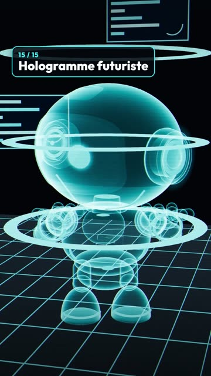

# 11 · Écrans & interfaces

[← Tous les styles](../README.md#les-110-styles) · 6 styles

- [Présentation tech sombre](#présentation-tech-sombre)
- [Mascotte dans une capture d'écran](#mascotte-dans-une-capture-décran)
- [Interface holographique](#interface-holographique)
- [Survol d'une application de bureau](#survol-dune-application-de-bureau)
- [Tableur cinématographique](#tableur-cinématographique)
- [Trame monochrome 1 bit](#trame-monochrome-1-bit)

## Présentation tech sombre

**Rendu :** fond noir, typographie généreuse, graphiques simples et pauses maîtrisées.

**1. Prompt image** (remplace les crochets)

```text
Image verticale 9:16. Style « Présentation tech sombre » : fond noir, typographie généreuse, graphiques simples et pauses maîtrisées.
Sujet : [PERSONNAGE — décris-le en une phrase : silhouette, couleurs, vêtements, signe distinctif], dans [SCÈNE — lieu, moment, lumière].
Moment représenté : juste avant l'action — [PERSONNAGE] révèle un seul argument sur un écran de conférence.
Composition lisible sur téléphone : personnage entier ou jusqu'aux genoux, mains visibles, silhouette claire, décor et objets originaux, éclairage cohérent avec le style.
À éviter : texte ou lettres générés, logos et marques, personnages existants, membres en trop, visage déformé.
```

**2. Prompt animation** (à partir de l'image obtenue)

```text
À partir de l'image fournie, crée un plan vertical de 3 à 5 secondes dans le style « Présentation tech sombre » (fond noir, typographie généreuse, graphiques simples et pauses maîtrisées).
Action unique et complète : [PERSONNAGE] révèle un seul argument sur un écran de conférence — avec une préparation du geste, le contact, la conséquence visible et une réaction.
Mouvement : éléments d'interface qui apparaissent, curseur, transitions de fenêtres.
Caméra : cadre d'écran stable, zooms sur la zone utile.
Garde le même personnage, les mêmes couleurs et les mêmes proportions du début à la fin ; aucun texte, aucun logo.
```

**3. Prompt pour l'animer en code** (Claude Code, ChatGPT, Codex…)

```text
Tu es un développeur d'animation. Avec Remotion (React) ou Three.js, crée une animation verticale 1080×1920 de 5 secondes à 30 i/s dans le style « Présentation tech sombre » : fond noir, typographie généreuse, graphiques simples et pauses maîtrisées.
Personnage : [PERSONNAGE — formes simples à construire en code, couleurs principales]. Scène : [SCÈNE].
Action : [PERSONNAGE] révèle un seul argument sur un écran de conférence (préparation, geste, conséquence, réaction ; le personnage se déplace et ses membres bougent, pas seulement la caméra).
Mouvement : éléments d'interface qui apparaissent, curseur, transitions de fenêtres. Caméra : cadre d'écran stable, zooms sur la zone utile.
Contraintes : rendu déterministe (aucun Math.random non initialisé), aucune ressource payante ni téléchargement, pas de texte généré dans l'image, code commenté et une commande pour exporter le MP4.
```

**Mouvement :** éléments d'interface qui apparaissent, curseur, transitions de fenêtres.  
**Caméra :** cadre d'écran stable, zooms sur la zone utile.  
**Outils :** générateur d'images puis image-vers-vidéo, ou motion design / 3D.  
**Limites :** une fausse interface doit être identifiée comme fictive ; préférer de vraies captures.  
**Statut :** prompt préparé, non testé.  
**Référence de style :** [Lemo-Opuscar](https://github.com/lemomo-ai/lemo-opuscar/blob/main/styles/dark-keynote/STYLE.md)

## Mascotte dans une capture d'écran

**Rendu :** interface fictive stylisée et petit avatar interactif sans copier d'autres marques.

**1. Prompt image** (remplace les crochets)

```text
Image verticale 9:16. Style « Mascotte dans une capture d'écran » : interface fictive stylisée et petit avatar interactif sans copier d'autres marques.
Sujet : [PERSONNAGE — décris-le en une phrase : silhouette, couleurs, vêtements, signe distinctif], dans [SCÈNE — lieu, moment, lumière].
Moment représenté : juste avant l'action — [PERSONNAGE] surgit d'une fenêtre et clique un composant réel de la maquette.
Composition lisible sur téléphone : personnage entier ou jusqu'aux genoux, mains visibles, silhouette claire, décor et objets originaux, éclairage cohérent avec le style.
À éviter : texte ou lettres générés, logos et marques, personnages existants, membres en trop, visage déformé.
```

**2. Prompt animation** (à partir de l'image obtenue)

```text
À partir de l'image fournie, crée un plan vertical de 3 à 5 secondes dans le style « Mascotte dans une capture d'écran » (interface fictive stylisée et petit avatar interactif sans copier d'autres marques).
Action unique et complète : [PERSONNAGE] surgit d'une fenêtre et clique un composant réel de la maquette — avec une préparation du geste, le contact, la conséquence visible et une réaction.
Mouvement : éléments d'interface qui apparaissent, curseur, transitions de fenêtres.
Caméra : cadre d'écran stable, zooms sur la zone utile.
Garde le même personnage, les mêmes couleurs et les mêmes proportions du début à la fin ; aucun texte, aucun logo.
```

**3. Prompt pour l'animer en code** (Claude Code, ChatGPT, Codex…)

```text
Tu es un développeur d'animation. Avec Remotion (React) ou Three.js, crée une animation verticale 1080×1920 de 5 secondes à 30 i/s dans le style « Mascotte dans une capture d'écran » : interface fictive stylisée et petit avatar interactif sans copier d'autres marques.
Personnage : [PERSONNAGE — formes simples à construire en code, couleurs principales]. Scène : [SCÈNE].
Action : [PERSONNAGE] surgit d'une fenêtre et clique un composant réel de la maquette (préparation, geste, conséquence, réaction ; le personnage se déplace et ses membres bougent, pas seulement la caméra).
Mouvement : éléments d'interface qui apparaissent, curseur, transitions de fenêtres. Caméra : cadre d'écran stable, zooms sur la zone utile.
Contraintes : rendu déterministe (aucun Math.random non initialisé), aucune ressource payante ni téléchargement, pas de texte généré dans l'image, code commenté et une commande pour exporter le MP4.
```

**Mouvement :** éléments d'interface qui apparaissent, curseur, transitions de fenêtres.  
**Caméra :** cadre d'écran stable, zooms sur la zone utile.  
**Outils :** générateur d'images puis image-vers-vidéo, ou motion design / 3D.  
**Limites :** une fausse interface doit être identifiée comme fictive ; préférer de vraies captures.  
**Statut :** prompt préparé, non testé.  
**Référence de style :** [Lemo-Opuscar](https://github.com/lemomo-ai/lemo-opuscar/blob/main/styles/living-screencast/STYLE.md)

## Interface holographique

**Rendu :** couches translucides cyan, jauges de fiction et profondeur optique.



*Exemple : image de notre vidéo, réalisée avec notre pipeline 3D (pas générée par ce prompt).*

**1. Prompt image** (remplace les crochets)

```text
Image verticale 9:16. Style « Interface holographique » : couches translucides cyan, jauges de fiction et profondeur optique.
Sujet : [PERSONNAGE — décris-le en une phrase : silhouette, couleurs, vêtements, signe distinctif], dans [SCÈNE — lieu, moment, lumière].
Moment représenté : juste avant l'action — [PERSONNAGE] fait pivoter un hologramme d'outil.
Composition lisible sur téléphone : personnage entier ou jusqu'aux genoux, mains visibles, silhouette claire, décor et objets originaux, éclairage cohérent avec le style.
À éviter : texte ou lettres générés, logos et marques, personnages existants, membres en trop, visage déformé.
```

**2. Prompt animation** (à partir de l'image obtenue)

```text
À partir de l'image fournie, crée un plan vertical de 3 à 5 secondes dans le style « Interface holographique » (couches translucides cyan, jauges de fiction et profondeur optique).
Action unique et complète : [PERSONNAGE] fait pivoter un hologramme d'outil — avec une préparation du geste, le contact, la conséquence visible et une réaction.
Mouvement : éléments d'interface qui apparaissent, curseur, transitions de fenêtres.
Caméra : cadre d'écran stable, zooms sur la zone utile.
Garde le même personnage, les mêmes couleurs et les mêmes proportions du début à la fin ; aucun texte, aucun logo.
```

**3. Prompt pour l'animer en code** (Claude Code, ChatGPT, Codex…)

```text
Tu es un développeur d'animation. Avec Remotion (React) ou Three.js, crée une animation verticale 1080×1920 de 5 secondes à 30 i/s dans le style « Interface holographique » : couches translucides cyan, jauges de fiction et profondeur optique.
Personnage : [PERSONNAGE — formes simples à construire en code, couleurs principales]. Scène : [SCÈNE].
Action : [PERSONNAGE] fait pivoter un hologramme d'outil (préparation, geste, conséquence, réaction ; le personnage se déplace et ses membres bougent, pas seulement la caméra).
Mouvement : éléments d'interface qui apparaissent, curseur, transitions de fenêtres. Caméra : cadre d'écran stable, zooms sur la zone utile.
Contraintes : rendu déterministe (aucun Math.random non initialisé), aucune ressource payante ni téléchargement, pas de texte généré dans l'image, code commenté et une commande pour exporter le MP4.
```

**Mouvement :** éléments d'interface qui apparaissent, curseur, transitions de fenêtres.  
**Caméra :** cadre d'écran stable, zooms sur la zone utile.  
**Outils :** générateur d'images puis image-vers-vidéo, ou motion design / 3D.  
**Limites :** une fausse interface doit être identifiée comme fictive ; préférer de vraies captures.  
**Statut :** prompt préparé, non testé.  
**Référence de style :** [Lemo-Opuscar](https://github.com/lemomo-ai/lemo-opuscar/blob/main/styles/hologram-hud/STYLE.md)

## Survol d'une application de bureau

**Rendu :** cartes UI ordonnées dans un espace 3D et caméra progressive.

**1. Prompt image** (remplace les crochets)

```text
Image verticale 9:16. Style « Survol d'une application de bureau » : cartes UI ordonnées dans un espace 3D et caméra progressive.
Sujet : [PERSONNAGE — décris-le en une phrase : silhouette, couleurs, vêtements, signe distinctif], dans [SCÈNE — lieu, moment, lumière].
Moment représenté : juste avant l'action — [PERSONNAGE] tire une carte d'interface vers le premier plan.
Composition lisible sur téléphone : personnage entier ou jusqu'aux genoux, mains visibles, silhouette claire, décor et objets originaux, éclairage cohérent avec le style.
À éviter : texte ou lettres générés, logos et marques, personnages existants, membres en trop, visage déformé.
```

**2. Prompt animation** (à partir de l'image obtenue)

```text
À partir de l'image fournie, crée un plan vertical de 3 à 5 secondes dans le style « Survol d'une application de bureau » (cartes UI ordonnées dans un espace 3D et caméra progressive).
Action unique et complète : [PERSONNAGE] tire une carte d'interface vers le premier plan — avec une préparation du geste, le contact, la conséquence visible et une réaction.
Mouvement : éléments d'interface qui apparaissent, curseur, transitions de fenêtres.
Caméra : cadre d'écran stable, zooms sur la zone utile.
Garde le même personnage, les mêmes couleurs et les mêmes proportions du début à la fin ; aucun texte, aucun logo.
```

**3. Prompt pour l'animer en code** (Claude Code, ChatGPT, Codex…)

```text
Tu es un développeur d'animation. Avec Remotion (React) ou Three.js, crée une animation verticale 1080×1920 de 5 secondes à 30 i/s dans le style « Survol d'une application de bureau » : cartes UI ordonnées dans un espace 3D et caméra progressive.
Personnage : [PERSONNAGE — formes simples à construire en code, couleurs principales]. Scène : [SCÈNE].
Action : [PERSONNAGE] tire une carte d'interface vers le premier plan (préparation, geste, conséquence, réaction ; le personnage se déplace et ses membres bougent, pas seulement la caméra).
Mouvement : éléments d'interface qui apparaissent, curseur, transitions de fenêtres. Caméra : cadre d'écran stable, zooms sur la zone utile.
Contraintes : rendu déterministe (aucun Math.random non initialisé), aucune ressource payante ni téléchargement, pas de texte généré dans l'image, code commenté et une commande pour exporter le MP4.
```

**Mouvement :** éléments d'interface qui apparaissent, curseur, transitions de fenêtres.  
**Caméra :** cadre d'écran stable, zooms sur la zone utile.  
**Outils :** générateur d'images puis image-vers-vidéo, ou motion design / 3D.  
**Limites :** une fausse interface doit être identifiée comme fictive ; préférer de vraies captures.  
**Statut :** prompt préparé, non testé.  
**Référence de style :** [Lemo-Opuscar](https://github.com/lemomo-ai/lemo-opuscar/blob/main/styles/desktop-flythrough/STYLE.md)

## Tableur cinématographique

**Rendu :** cellules animées, sélection contrôlée et graphiques de données d'exemple.

**1. Prompt image** (remplace les crochets)

```text
Image verticale 9:16. Style « Tableur cinématographique » : cellules animées, sélection contrôlée et graphiques de données d'exemple.
Sujet : [PERSONNAGE — décris-le en une phrase : silhouette, couleurs, vêtements, signe distinctif], dans [SCÈNE — lieu, moment, lumière].
Moment représenté : juste avant l'action — [PERSONNAGE] sélectionne une cellule qui produit un graphique.
Composition lisible sur téléphone : personnage entier ou jusqu'aux genoux, mains visibles, silhouette claire, décor et objets originaux, éclairage cohérent avec le style.
À éviter : texte ou lettres générés, logos et marques, personnages existants, membres en trop, visage déformé.
```

**2. Prompt animation** (à partir de l'image obtenue)

```text
À partir de l'image fournie, crée un plan vertical de 3 à 5 secondes dans le style « Tableur cinématographique » (cellules animées, sélection contrôlée et graphiques de données d'exemple).
Action unique et complète : [PERSONNAGE] sélectionne une cellule qui produit un graphique — avec une préparation du geste, le contact, la conséquence visible et une réaction.
Mouvement : éléments d'interface qui apparaissent, curseur, transitions de fenêtres.
Caméra : cadre d'écran stable, zooms sur la zone utile.
Garde le même personnage, les mêmes couleurs et les mêmes proportions du début à la fin ; aucun texte, aucun logo.
```

**3. Prompt pour l'animer en code** (Claude Code, ChatGPT, Codex…)

```text
Tu es un développeur d'animation. Avec Remotion (React) ou Three.js, crée une animation verticale 1080×1920 de 5 secondes à 30 i/s dans le style « Tableur cinématographique » : cellules animées, sélection contrôlée et graphiques de données d'exemple.
Personnage : [PERSONNAGE — formes simples à construire en code, couleurs principales]. Scène : [SCÈNE].
Action : [PERSONNAGE] sélectionne une cellule qui produit un graphique (préparation, geste, conséquence, réaction ; le personnage se déplace et ses membres bougent, pas seulement la caméra).
Mouvement : éléments d'interface qui apparaissent, curseur, transitions de fenêtres. Caméra : cadre d'écran stable, zooms sur la zone utile.
Contraintes : rendu déterministe (aucun Math.random non initialisé), aucune ressource payante ni téléchargement, pas de texte généré dans l'image, code commenté et une commande pour exporter le MP4.
```

**Mouvement :** éléments d'interface qui apparaissent, curseur, transitions de fenêtres.  
**Caméra :** cadre d'écran stable, zooms sur la zone utile.  
**Outils :** générateur d'images puis image-vers-vidéo, ou motion design / 3D.  
**Limites :** une fausse interface doit être identifiée comme fictive ; préférer de vraies captures.  
**Statut :** prompt préparé, non testé.  
**Référence de style :** [Lemo-Opuscar](https://github.com/lemomo-ai/lemo-opuscar/blob/main/styles/spreadsheet/STYLE.md)

## Trame monochrome 1 bit

**Rendu :** noir-blanc tramé, motifs de diffusion et silhouettes simplifiées.

**1. Prompt image** (remplace les crochets)

```text
Image verticale 9:16. Style « Trame monochrome 1 bit » : noir-blanc tramé, motifs de diffusion et silhouettes simplifiées.
Sujet : [PERSONNAGE — décris-le en une phrase : silhouette, couleurs, vêtements, signe distinctif], dans [SCÈNE — lieu, moment, lumière].
Moment représenté : juste avant l'action — [PERSONNAGE] devient une forme monochrome et cligne des yeux.
Composition lisible sur téléphone : personnage entier ou jusqu'aux genoux, mains visibles, silhouette claire, décor et objets originaux, éclairage cohérent avec le style.
À éviter : texte ou lettres générés, logos et marques, personnages existants, membres en trop, visage déformé.
```

**2. Prompt animation** (à partir de l'image obtenue)

```text
À partir de l'image fournie, crée un plan vertical de 3 à 5 secondes dans le style « Trame monochrome 1 bit » (noir-blanc tramé, motifs de diffusion et silhouettes simplifiées).
Action unique et complète : [PERSONNAGE] devient une forme monochrome et cligne des yeux — avec une préparation du geste, le contact, la conséquence visible et une réaction.
Mouvement : éléments d'interface qui apparaissent, curseur, transitions de fenêtres.
Caméra : cadre d'écran stable, zooms sur la zone utile.
Garde le même personnage, les mêmes couleurs et les mêmes proportions du début à la fin ; aucun texte, aucun logo.
```

**3. Prompt pour l'animer en code** (Claude Code, ChatGPT, Codex…)

```text
Tu es un développeur d'animation. Avec Remotion (React) ou Three.js, crée une animation verticale 1080×1920 de 5 secondes à 30 i/s dans le style « Trame monochrome 1 bit » : noir-blanc tramé, motifs de diffusion et silhouettes simplifiées.
Personnage : [PERSONNAGE — formes simples à construire en code, couleurs principales]. Scène : [SCÈNE].
Action : [PERSONNAGE] devient une forme monochrome et cligne des yeux (préparation, geste, conséquence, réaction ; le personnage se déplace et ses membres bougent, pas seulement la caméra).
Mouvement : éléments d'interface qui apparaissent, curseur, transitions de fenêtres. Caméra : cadre d'écran stable, zooms sur la zone utile.
Contraintes : rendu déterministe (aucun Math.random non initialisé), aucune ressource payante ni téléchargement, pas de texte généré dans l'image, code commenté et une commande pour exporter le MP4.
```

**Mouvement :** éléments d'interface qui apparaissent, curseur, transitions de fenêtres.  
**Caméra :** cadre d'écran stable, zooms sur la zone utile.  
**Outils :** générateur d'images puis image-vers-vidéo, ou motion design / 3D.  
**Limites :** une fausse interface doit être identifiée comme fictive ; préférer de vraies captures.  
**Statut :** prompt préparé, non testé.  
**Référence de style :** [Lemo-Opuscar](https://github.com/lemomo-ai/lemo-opuscar/blob/main/styles/one-bit-dither/STYLE.md)

