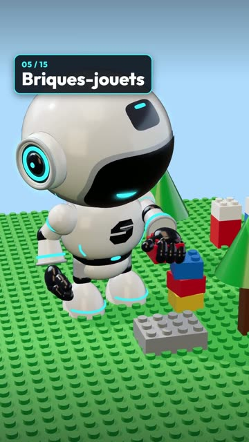
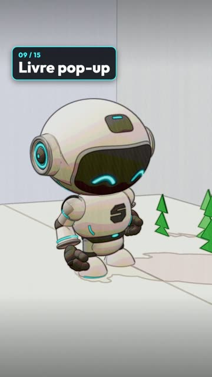

# 13 · 3D & miniatures

[← Tous les styles](../README.md#les-110-styles) · 8 styles

- [Univers de briques-jouets](#univers-de-briques-jouets)
- [Livre pop-up](#livre-pop-up)
- [Miniature en bascule-décentrement](#miniature-en-bascule-décentrement)
- [Île isométrique low-poly](#île-isométrique-low-poly)
- [Rendu de produit en verre](#rendu-de-produit-en-verre)
- [Diorama Memphis](#diorama-memphis)
- [Petit monde isométrique](#petit-monde-isométrique)
- [Monde 3D dessiné au crayon](#monde-3d-dessiné-au-crayon)

## Univers de briques-jouets

**Rendu :** assemblages de pièces plastique, tenons visibles et éclairage de maquette.



*Exemple : image de notre vidéo, réalisée avec notre pipeline 3D (pas générée par ce prompt).*

**1. Prompt image** (remplace les crochets)

```text
Image verticale 9:16. Style « Univers de briques-jouets » : assemblages de pièces plastique, tenons visibles et éclairage de maquette.
Sujet : [PERSONNAGE — décris-le en une phrase : silhouette, couleurs, vêtements, signe distinctif], dans [SCÈNE — lieu, moment, lumière].
Moment représenté : juste avant l'action — [PERSONNAGE] assemble un pont de briques puis le traverse.
Composition lisible sur téléphone : personnage entier ou jusqu'aux genoux, mains visibles, silhouette claire, décor et objets originaux, éclairage cohérent avec le style.
À éviter : texte ou lettres générés, logos et marques, personnages existants, membres en trop, visage déformé.
```

**2. Prompt animation** (à partir de l'image obtenue)

```text
À partir de l'image fournie, crée un plan vertical de 3 à 5 secondes dans le style « Univers de briques-jouets » (assemblages de pièces plastique, tenons visibles et éclairage de maquette).
Action unique et complète : [PERSONNAGE] assemble un pont de briques puis le traverse — avec une préparation du geste, le contact, la conséquence visible et une réaction.
Mouvement : miniature : mouvements d'objets à la main, stop motion possible.
Caméra : orbite lente, plongée de maquette, flou de mise au point.
Garde le même personnage, les mêmes couleurs et les mêmes proportions du début à la fin ; aucun texte, aucun logo.
```

**3. Prompt pour l'animer en code** (Claude Code, ChatGPT, Codex…)

```text
Tu es un développeur d'animation. Avec Remotion (React) ou Three.js, crée une animation verticale 1080×1920 de 5 secondes à 30 i/s dans le style « Univers de briques-jouets » : assemblages de pièces plastique, tenons visibles et éclairage de maquette.
Personnage : [PERSONNAGE — formes simples à construire en code, couleurs principales]. Scène : [SCÈNE].
Action : [PERSONNAGE] assemble un pont de briques puis le traverse (préparation, geste, conséquence, réaction ; le personnage se déplace et ses membres bougent, pas seulement la caméra).
Mouvement : miniature : mouvements d'objets à la main, stop motion possible. Caméra : orbite lente, plongée de maquette, flou de mise au point.
Contraintes : rendu déterministe (aucun Math.random non initialisé), aucune ressource payante ni téléchargement, pas de texte généré dans l'image, code commenté et une commande pour exporter le MP4.
```

**Mouvement :** miniature : mouvements d'objets à la main, stop motion possible.  
**Caméra :** orbite lente, plongée de maquette, flou de mise au point.  
**Outils :** générateur d'images puis image-vers-vidéo, ou motion design / 3D.  
**Limites :** garder des échelles cohérentes entre le personnage et les objets.  
**Statut :** prompt préparé, non testé.  
**Référence de style :** [Lemo-Opuscar](https://github.com/lemomo-ai/lemo-opuscar/blob/main/styles/brick-toy/STYLE.md)

## Livre pop-up

**Rendu :** personnages en cartes découpées, pliures articulées et caméra macro.



*Exemple : image de notre vidéo, réalisée avec notre pipeline 3D (pas générée par ce prompt).*

**1. Prompt image** (remplace les crochets)

```text
Image verticale 9:16. Style « Livre pop-up » : personnages en cartes découpées, pliures articulées et caméra macro.
Sujet : [PERSONNAGE — décris-le en une phrase : silhouette, couleurs, vêtements, signe distinctif], dans [SCÈNE — lieu, moment, lumière].
Moment représenté : juste avant l'action — [PERSONNAGE] soulève une languette et déploie un décor entier.
Composition lisible sur téléphone : personnage entier ou jusqu'aux genoux, mains visibles, silhouette claire, décor et objets originaux, éclairage cohérent avec le style.
À éviter : texte ou lettres générés, logos et marques, personnages existants, membres en trop, visage déformé.
```

**2. Prompt animation** (à partir de l'image obtenue)

```text
À partir de l'image fournie, crée un plan vertical de 3 à 5 secondes dans le style « Livre pop-up » (personnages en cartes découpées, pliures articulées et caméra macro).
Action unique et complète : [PERSONNAGE] soulève une languette et déploie un décor entier — avec une préparation du geste, le contact, la conséquence visible et une réaction.
Mouvement : miniature : mouvements d'objets à la main, stop motion possible.
Caméra : orbite lente, plongée de maquette, flou de mise au point.
Garde le même personnage, les mêmes couleurs et les mêmes proportions du début à la fin ; aucun texte, aucun logo.
```

**3. Prompt pour l'animer en code** (Claude Code, ChatGPT, Codex…)

```text
Tu es un développeur d'animation. Avec Remotion (React) ou Three.js, crée une animation verticale 1080×1920 de 5 secondes à 30 i/s dans le style « Livre pop-up » : personnages en cartes découpées, pliures articulées et caméra macro.
Personnage : [PERSONNAGE — formes simples à construire en code, couleurs principales]. Scène : [SCÈNE].
Action : [PERSONNAGE] soulève une languette et déploie un décor entier (préparation, geste, conséquence, réaction ; le personnage se déplace et ses membres bougent, pas seulement la caméra).
Mouvement : miniature : mouvements d'objets à la main, stop motion possible. Caméra : orbite lente, plongée de maquette, flou de mise au point.
Contraintes : rendu déterministe (aucun Math.random non initialisé), aucune ressource payante ni téléchargement, pas de texte généré dans l'image, code commenté et une commande pour exporter le MP4.
```

**Mouvement :** miniature : mouvements d'objets à la main, stop motion possible.  
**Caméra :** orbite lente, plongée de maquette, flou de mise au point.  
**Outils :** générateur d'images puis image-vers-vidéo, ou motion design / 3D.  
**Limites :** garder des échelles cohérentes entre le personnage et les objets.  
**Statut :** prompt préparé, non testé.  
**Référence de style :** [Lemo-Opuscar](https://github.com/lemomo-ai/lemo-opuscar/blob/main/styles/paper-popup/STYLE.md)

## Miniature en bascule-décentrement

**Rendu :** maquettes réduites et profondeur de champ sélective.

**1. Prompt image** (remplace les crochets)

```text
Image verticale 9:16. Style « Miniature en bascule-décentrement » : maquettes réduites et profondeur de champ sélective.
Sujet : [PERSONNAGE — décris-le en une phrase : silhouette, couleurs, vêtements, signe distinctif], dans [SCÈNE — lieu, moment, lumière].
Moment représenté : juste avant l'action — [PERSONNAGE] marche entre deux immeubles miniatures.
Composition lisible sur téléphone : personnage entier ou jusqu'aux genoux, mains visibles, silhouette claire, décor et objets originaux, éclairage cohérent avec le style.
À éviter : texte ou lettres générés, logos et marques, personnages existants, membres en trop, visage déformé.
```

**2. Prompt animation** (à partir de l'image obtenue)

```text
À partir de l'image fournie, crée un plan vertical de 3 à 5 secondes dans le style « Miniature en bascule-décentrement » (maquettes réduites et profondeur de champ sélective).
Action unique et complète : [PERSONNAGE] marche entre deux immeubles miniatures — avec une préparation du geste, le contact, la conséquence visible et une réaction.
Mouvement : miniature : mouvements d'objets à la main, stop motion possible.
Caméra : orbite lente, plongée de maquette, flou de mise au point.
Garde le même personnage, les mêmes couleurs et les mêmes proportions du début à la fin ; aucun texte, aucun logo.
```

**3. Prompt pour l'animer en code** (Claude Code, ChatGPT, Codex…)

```text
Tu es un développeur d'animation. Avec Remotion (React) ou Three.js, crée une animation verticale 1080×1920 de 5 secondes à 30 i/s dans le style « Miniature en bascule-décentrement » : maquettes réduites et profondeur de champ sélective.
Personnage : [PERSONNAGE — formes simples à construire en code, couleurs principales]. Scène : [SCÈNE].
Action : [PERSONNAGE] marche entre deux immeubles miniatures (préparation, geste, conséquence, réaction ; le personnage se déplace et ses membres bougent, pas seulement la caméra).
Mouvement : miniature : mouvements d'objets à la main, stop motion possible. Caméra : orbite lente, plongée de maquette, flou de mise au point.
Contraintes : rendu déterministe (aucun Math.random non initialisé), aucune ressource payante ni téléchargement, pas de texte généré dans l'image, code commenté et une commande pour exporter le MP4.
```

**Mouvement :** miniature : mouvements d'objets à la main, stop motion possible.  
**Caméra :** orbite lente, plongée de maquette, flou de mise au point.  
**Outils :** générateur d'images puis image-vers-vidéo, ou motion design / 3D.  
**Limites :** garder des échelles cohérentes entre le personnage et les objets.  
**Statut :** prompt préparé, non testé.  
**Référence de style :** [Lemo-Opuscar](https://github.com/lemomo-ai/lemo-opuscar/blob/main/styles/tilt-shift/STYLE.md)

## Île isométrique low-poly

**Rendu :** formes polygonales facettées et lumière douce sur une petite île.

**1. Prompt image** (remplace les crochets)

```text
Image verticale 9:16. Style « Île isométrique low-poly » : formes polygonales facettées et lumière douce sur une petite île.
Sujet : [PERSONNAGE — décris-le en une phrase : silhouette, couleurs, vêtements, signe distinctif], dans [SCÈNE — lieu, moment, lumière].
Moment représenté : juste avant l'action — [PERSONNAGE] plante un objet qui fait pousser un décor géométrique.
Composition lisible sur téléphone : personnage entier ou jusqu'aux genoux, mains visibles, silhouette claire, décor et objets originaux, éclairage cohérent avec le style.
À éviter : texte ou lettres générés, logos et marques, personnages existants, membres en trop, visage déformé.
```

**2. Prompt animation** (à partir de l'image obtenue)

```text
À partir de l'image fournie, crée un plan vertical de 3 à 5 secondes dans le style « Île isométrique low-poly » (formes polygonales facettées et lumière douce sur une petite île).
Action unique et complète : [PERSONNAGE] plante un objet qui fait pousser un décor géométrique — avec une préparation du geste, le contact, la conséquence visible et une réaction.
Mouvement : miniature : mouvements d'objets à la main, stop motion possible.
Caméra : orbite lente, plongée de maquette, flou de mise au point.
Garde le même personnage, les mêmes couleurs et les mêmes proportions du début à la fin ; aucun texte, aucun logo.
```

**3. Prompt pour l'animer en code** (Claude Code, ChatGPT, Codex…)

```text
Tu es un développeur d'animation. Avec Remotion (React) ou Three.js, crée une animation verticale 1080×1920 de 5 secondes à 30 i/s dans le style « Île isométrique low-poly » : formes polygonales facettées et lumière douce sur une petite île.
Personnage : [PERSONNAGE — formes simples à construire en code, couleurs principales]. Scène : [SCÈNE].
Action : [PERSONNAGE] plante un objet qui fait pousser un décor géométrique (préparation, geste, conséquence, réaction ; le personnage se déplace et ses membres bougent, pas seulement la caméra).
Mouvement : miniature : mouvements d'objets à la main, stop motion possible. Caméra : orbite lente, plongée de maquette, flou de mise au point.
Contraintes : rendu déterministe (aucun Math.random non initialisé), aucune ressource payante ni téléchargement, pas de texte généré dans l'image, code commenté et une commande pour exporter le MP4.
```

**Mouvement :** miniature : mouvements d'objets à la main, stop motion possible.  
**Caméra :** orbite lente, plongée de maquette, flou de mise au point.  
**Outils :** générateur d'images puis image-vers-vidéo, ou motion design / 3D.  
**Limites :** garder des échelles cohérentes entre le personnage et les objets.  
**Statut :** prompt préparé, non testé.  
**Référence de style :** [Lemo-Opuscar](https://github.com/lemomo-ai/lemo-opuscar/blob/main/styles/lowpoly-island/STYLE.md)

## Rendu de produit en verre

**Rendu :** transparence physique, réflexions douces et lumière de studio.

**1. Prompt image** (remplace les crochets)

```text
Image verticale 9:16. Style « Rendu de produit en verre » : transparence physique, réflexions douces et lumière de studio.
Sujet : [PERSONNAGE — décris-le en une phrase : silhouette, couleurs, vêtements, signe distinctif], dans [SCÈNE — lieu, moment, lumière].
Moment représenté : juste avant l'action — [PERSONNAGE] pose une sphère de verre qui réfracte le monde.
Composition lisible sur téléphone : personnage entier ou jusqu'aux genoux, mains visibles, silhouette claire, décor et objets originaux, éclairage cohérent avec le style.
À éviter : texte ou lettres générés, logos et marques, personnages existants, membres en trop, visage déformé.
```

**2. Prompt animation** (à partir de l'image obtenue)

```text
À partir de l'image fournie, crée un plan vertical de 3 à 5 secondes dans le style « Rendu de produit en verre » (transparence physique, réflexions douces et lumière de studio).
Action unique et complète : [PERSONNAGE] pose une sphère de verre qui réfracte le monde — avec une préparation du geste, le contact, la conséquence visible et une réaction.
Mouvement : miniature : mouvements d'objets à la main, stop motion possible.
Caméra : orbite lente, plongée de maquette, flou de mise au point.
Garde le même personnage, les mêmes couleurs et les mêmes proportions du début à la fin ; aucun texte, aucun logo.
```

**3. Prompt pour l'animer en code** (Claude Code, ChatGPT, Codex…)

```text
Tu es un développeur d'animation. Avec Remotion (React) ou Three.js, crée une animation verticale 1080×1920 de 5 secondes à 30 i/s dans le style « Rendu de produit en verre » : transparence physique, réflexions douces et lumière de studio.
Personnage : [PERSONNAGE — formes simples à construire en code, couleurs principales]. Scène : [SCÈNE].
Action : [PERSONNAGE] pose une sphère de verre qui réfracte le monde (préparation, geste, conséquence, réaction ; le personnage se déplace et ses membres bougent, pas seulement la caméra).
Mouvement : miniature : mouvements d'objets à la main, stop motion possible. Caméra : orbite lente, plongée de maquette, flou de mise au point.
Contraintes : rendu déterministe (aucun Math.random non initialisé), aucune ressource payante ni téléchargement, pas de texte généré dans l'image, code commenté et une commande pour exporter le MP4.
```

**Mouvement :** miniature : mouvements d'objets à la main, stop motion possible.  
**Caméra :** orbite lente, plongée de maquette, flou de mise au point.  
**Outils :** générateur d'images puis image-vers-vidéo, ou motion design / 3D.  
**Limites :** garder des échelles cohérentes entre le personnage et les objets.  
**Statut :** prompt préparé, non testé.  
**Référence de style :** [Lemo-Opuscar](https://github.com/lemomo-ai/lemo-opuscar/blob/main/styles/glass-product/STYLE.md)

## Diorama Memphis

**Rendu :** motifs ludiques géométriques et volumes de maquette aux couleurs choisies.

**1. Prompt image** (remplace les crochets)

```text
Image verticale 9:16. Style « Diorama Memphis » : motifs ludiques géométriques et volumes de maquette aux couleurs choisies.
Sujet : [PERSONNAGE — décris-le en une phrase : silhouette, couleurs, vêtements, signe distinctif], dans [SCÈNE — lieu, moment, lumière].
Moment représenté : juste avant l'action — [PERSONNAGE] saute d'un bloc coloré à l'autre.
Composition lisible sur téléphone : personnage entier ou jusqu'aux genoux, mains visibles, silhouette claire, décor et objets originaux, éclairage cohérent avec le style.
À éviter : texte ou lettres générés, logos et marques, personnages existants, membres en trop, visage déformé.
```

**2. Prompt animation** (à partir de l'image obtenue)

```text
À partir de l'image fournie, crée un plan vertical de 3 à 5 secondes dans le style « Diorama Memphis » (motifs ludiques géométriques et volumes de maquette aux couleurs choisies).
Action unique et complète : [PERSONNAGE] saute d'un bloc coloré à l'autre — avec une préparation du geste, le contact, la conséquence visible et une réaction.
Mouvement : miniature : mouvements d'objets à la main, stop motion possible.
Caméra : orbite lente, plongée de maquette, flou de mise au point.
Garde le même personnage, les mêmes couleurs et les mêmes proportions du début à la fin ; aucun texte, aucun logo.
```

**3. Prompt pour l'animer en code** (Claude Code, ChatGPT, Codex…)

```text
Tu es un développeur d'animation. Avec Remotion (React) ou Three.js, crée une animation verticale 1080×1920 de 5 secondes à 30 i/s dans le style « Diorama Memphis » : motifs ludiques géométriques et volumes de maquette aux couleurs choisies.
Personnage : [PERSONNAGE — formes simples à construire en code, couleurs principales]. Scène : [SCÈNE].
Action : [PERSONNAGE] saute d'un bloc coloré à l'autre (préparation, geste, conséquence, réaction ; le personnage se déplace et ses membres bougent, pas seulement la caméra).
Mouvement : miniature : mouvements d'objets à la main, stop motion possible. Caméra : orbite lente, plongée de maquette, flou de mise au point.
Contraintes : rendu déterministe (aucun Math.random non initialisé), aucune ressource payante ni téléchargement, pas de texte généré dans l'image, code commenté et une commande pour exporter le MP4.
```

**Mouvement :** miniature : mouvements d'objets à la main, stop motion possible.  
**Caméra :** orbite lente, plongée de maquette, flou de mise au point.  
**Outils :** générateur d'images puis image-vers-vidéo, ou motion design / 3D.  
**Limites :** garder des échelles cohérentes entre le personnage et les objets.  
**Statut :** prompt préparé, non testé.  
**Référence de style :** [Lemo-Opuscar](https://github.com/lemomo-ai/lemo-opuscar/blob/main/styles/memphis-diorama/STYLE.md)

## Petit monde isométrique

**Rendu :** figurines volumétriques petites, décors sur grille isométrique.

**1. Prompt image** (remplace les crochets)

```text
Image verticale 9:16. Style « Petit monde isométrique » : figurines volumétriques petites, décors sur grille isométrique.
Sujet : [PERSONNAGE — décris-le en une phrase : silhouette, couleurs, vêtements, signe distinctif], dans [SCÈNE — lieu, moment, lumière].
Moment représenté : juste avant l'action — [PERSONNAGE] traverse la pièce pour déclencher une porte.
Composition lisible sur téléphone : personnage entier ou jusqu'aux genoux, mains visibles, silhouette claire, décor et objets originaux, éclairage cohérent avec le style.
À éviter : texte ou lettres générés, logos et marques, personnages existants, membres en trop, visage déformé.
```

**2. Prompt animation** (à partir de l'image obtenue)

```text
À partir de l'image fournie, crée un plan vertical de 3 à 5 secondes dans le style « Petit monde isométrique » (figurines volumétriques petites, décors sur grille isométrique).
Action unique et complète : [PERSONNAGE] traverse la pièce pour déclencher une porte — avec une préparation du geste, le contact, la conséquence visible et une réaction.
Mouvement : miniature : mouvements d'objets à la main, stop motion possible.
Caméra : orbite lente, plongée de maquette, flou de mise au point.
Garde le même personnage, les mêmes couleurs et les mêmes proportions du début à la fin ; aucun texte, aucun logo.
```

**3. Prompt pour l'animer en code** (Claude Code, ChatGPT, Codex…)

```text
Tu es un développeur d'animation. Avec Remotion (React) ou Three.js, crée une animation verticale 1080×1920 de 5 secondes à 30 i/s dans le style « Petit monde isométrique » : figurines volumétriques petites, décors sur grille isométrique.
Personnage : [PERSONNAGE — formes simples à construire en code, couleurs principales]. Scène : [SCÈNE].
Action : [PERSONNAGE] traverse la pièce pour déclencher une porte (préparation, geste, conséquence, réaction ; le personnage se déplace et ses membres bougent, pas seulement la caméra).
Mouvement : miniature : mouvements d'objets à la main, stop motion possible. Caméra : orbite lente, plongée de maquette, flou de mise au point.
Contraintes : rendu déterministe (aucun Math.random non initialisé), aucune ressource payante ni téléchargement, pas de texte généré dans l'image, code commenté et une commande pour exporter le MP4.
```

**Mouvement :** miniature : mouvements d'objets à la main, stop motion possible.  
**Caméra :** orbite lente, plongée de maquette, flou de mise au point.  
**Outils :** générateur d'images puis image-vers-vidéo, ou motion design / 3D.  
**Limites :** garder des échelles cohérentes entre le personnage et les objets.  
**Statut :** prompt préparé, non testé.  
**Référence de style :** [Lemo-Opuscar](https://github.com/lemomo-ai/lemo-opuscar/blob/main/styles/isometric-picture-book/STYLE.md)

## Monde 3D dessiné au crayon

**Rendu :** objets 3D ayant texture de crayon pastel et contours irréguliers.

**1. Prompt image** (remplace les crochets)

```text
Image verticale 9:16. Style « Monde 3D dessiné au crayon » : objets 3D ayant texture de crayon pastel et contours irréguliers.
Sujet : [PERSONNAGE — décris-le en une phrase : silhouette, couleurs, vêtements, signe distinctif], dans [SCÈNE — lieu, moment, lumière].
Moment représenté : juste avant l'action — [PERSONNAGE] façonne une colline en traçant un cercle.
Composition lisible sur téléphone : personnage entier ou jusqu'aux genoux, mains visibles, silhouette claire, décor et objets originaux, éclairage cohérent avec le style.
À éviter : texte ou lettres générés, logos et marques, personnages existants, membres en trop, visage déformé.
```

**2. Prompt animation** (à partir de l'image obtenue)

```text
À partir de l'image fournie, crée un plan vertical de 3 à 5 secondes dans le style « Monde 3D dessiné au crayon » (objets 3D ayant texture de crayon pastel et contours irréguliers).
Action unique et complète : [PERSONNAGE] façonne une colline en traçant un cercle — avec une préparation du geste, le contact, la conséquence visible et une réaction.
Mouvement : miniature : mouvements d'objets à la main, stop motion possible.
Caméra : orbite lente, plongée de maquette, flou de mise au point.
Garde le même personnage, les mêmes couleurs et les mêmes proportions du début à la fin ; aucun texte, aucun logo.
```

**3. Prompt pour l'animer en code** (Claude Code, ChatGPT, Codex…)

```text
Tu es un développeur d'animation. Avec Remotion (React) ou Three.js, crée une animation verticale 1080×1920 de 5 secondes à 30 i/s dans le style « Monde 3D dessiné au crayon » : objets 3D ayant texture de crayon pastel et contours irréguliers.
Personnage : [PERSONNAGE — formes simples à construire en code, couleurs principales]. Scène : [SCÈNE].
Action : [PERSONNAGE] façonne une colline en traçant un cercle (préparation, geste, conséquence, réaction ; le personnage se déplace et ses membres bougent, pas seulement la caméra).
Mouvement : miniature : mouvements d'objets à la main, stop motion possible. Caméra : orbite lente, plongée de maquette, flou de mise au point.
Contraintes : rendu déterministe (aucun Math.random non initialisé), aucune ressource payante ni téléchargement, pas de texte généré dans l'image, code commenté et une commande pour exporter le MP4.
```

**Mouvement :** miniature : mouvements d'objets à la main, stop motion possible.  
**Caméra :** orbite lente, plongée de maquette, flou de mise au point.  
**Outils :** générateur d'images puis image-vers-vidéo, ou motion design / 3D.  
**Limites :** garder des échelles cohérentes entre le personnage et les objets.  
**Statut :** prompt préparé, non testé.  
**Référence de style :** [Lemo-Opuscar](https://github.com/lemomo-ai/lemo-opuscar/blob/main/styles/crayon-world/STYLE.md)

