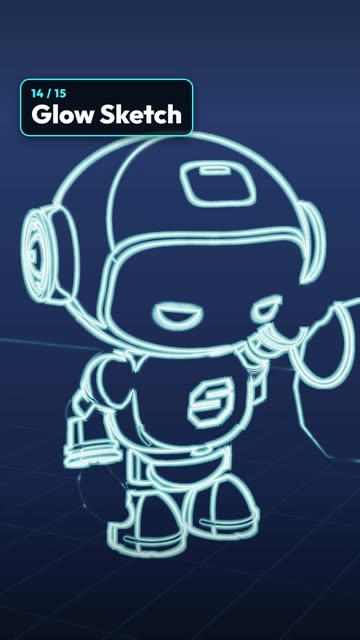
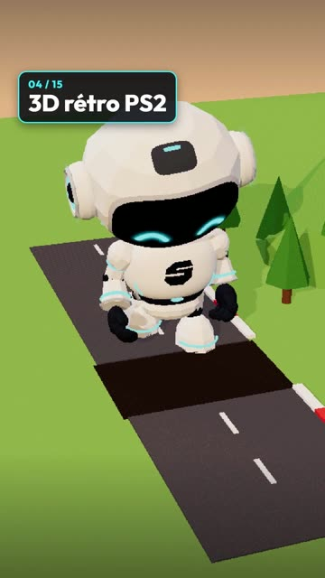
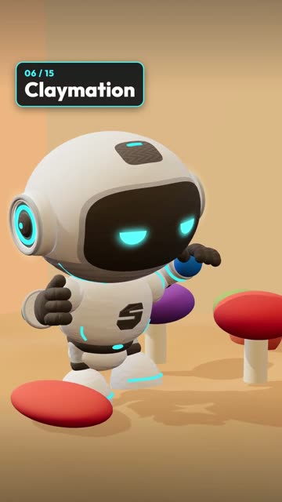
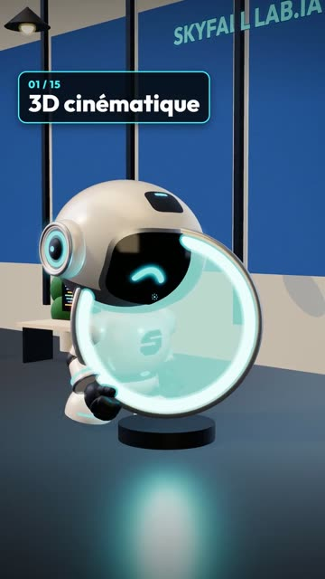

# 16 · Styles complémentaires

[← Tous les styles](../README.md#les-110-styles) · 11 styles

- [Glow Sketch](#glow-sketch)
- [Jeu 3D rétro PS2](#jeu-3d-rétro-ps2)
- [Claymation](#claymation)
- [Papier découpé en couches](#papier-découpé-en-couches)
- [Laine et feutre](#laine-et-feutre)
- [Vectoriel plat](#vectoriel-plat)
- [Minimal Line](#minimal-line)
- [CGI cinématographique](#cgi-cinématographique)
- [3D pédagogique](#3d-pédagogique)
- [Collage éditorial](#collage-éditorial)
- [Captation smartphone réaliste](#captation-smartphone-réaliste)

## Glow Sketch

**Rendu :** traits lumineux cyan/or sur noir profond et volumes suggérés.



*Exemple : image de notre vidéo, réalisée avec notre pipeline 3D (pas générée par ce prompt).*

**1. Prompt image** (remplace les crochets)

```text
Image verticale 9:16. Style « Glow Sketch » : traits lumineux cyan/or sur noir profond et volumes suggérés.
Sujet : [PERSONNAGE — décris-le en une phrase : silhouette, couleurs, vêtements, signe distinctif], dans [SCÈNE — lieu, moment, lumière].
Moment représenté : juste avant l'action — [PERSONNAGE] trace un contour au doigt, le monde s'éclaire.
Composition lisible sur téléphone : personnage entier ou jusqu'aux genoux, mains visibles, silhouette claire, décor et objets originaux, éclairage cohérent avec le style.
À éviter : texte ou lettres générés, logos et marques, personnages existants, membres en trop, visage déformé.
```

**2. Prompt animation** (à partir de l'image obtenue)

```text
À partir de l'image fournie, crée un plan vertical de 3 à 5 secondes dans le style « Glow Sketch » (traits lumineux cyan/or sur noir profond et volumes suggérés).
Action unique et complète : [PERSONNAGE] trace un contour au doigt, le monde s'éclaire — avec une préparation du geste, le contact, la conséquence visible et une réaction.
Mouvement : action entière et lisible : préparation, geste, conséquence, réaction.
Caméra : cadrage qui montre les mains et les pieds quand c'est utile.
Garde le même personnage, les mêmes couleurs et les mêmes proportions du début à la fin ; aucun texte, aucun logo.
```

**3. Prompt pour l'animer en code** (Claude Code, ChatGPT, Codex…)

```text
Tu es un développeur d'animation. Avec Remotion (React) ou Three.js, crée une animation verticale 1080×1920 de 5 secondes à 30 i/s dans le style « Glow Sketch » : traits lumineux cyan/or sur noir profond et volumes suggérés.
Personnage : [PERSONNAGE — formes simples à construire en code, couleurs principales]. Scène : [SCÈNE].
Action : [PERSONNAGE] trace un contour au doigt, le monde s'éclaire (préparation, geste, conséquence, réaction ; le personnage se déplace et ses membres bougent, pas seulement la caméra).
Mouvement : action entière et lisible : préparation, geste, conséquence, réaction. Caméra : cadrage qui montre les mains et les pieds quand c'est utile.
Contraintes : rendu déterministe (aucun Math.random non initialisé), aucune ressource payante ni téléchargement, pas de texte généré dans l'image, code commenté et une commande pour exporter le MP4.
```

**Mouvement :** action entière et lisible : préparation, geste, conséquence, réaction.  
**Caméra :** cadrage qui montre les mains et les pieds quand c'est utile.  
**Outils :** générateur d'images puis image-vers-vidéo, ou motion design / 3D.  
**Limites :** la cohérence du personnage dépend de l'image de référence : la réutiliser à chaque plan.  
**Statut :** prompt préparé, non testé.  
**Référence de style :** 10 Claude Animation Styles (document fourni)

## Jeu 3D rétro PS2

**Rendu :** géométrie 3D simplifiée, textures basse résolution, léger brouillard de distance.



*Exemple : image de notre vidéo, réalisée avec notre pipeline 3D (pas générée par ce prompt).*

**1. Prompt image** (remplace les crochets)

```text
Image verticale 9:16. Style « Jeu 3D rétro PS2 » : géométrie 3D simplifiée, textures basse résolution, léger brouillard de distance.
Sujet : [PERSONNAGE — décris-le en une phrase : silhouette, couleurs, vêtements, signe distinctif], dans [SCÈNE — lieu, moment, lumière].
Moment représenté : juste avant l'action — [PERSONNAGE] court dans un niveau de console fictif puis pousse un levier.
Composition lisible sur téléphone : personnage entier ou jusqu'aux genoux, mains visibles, silhouette claire, décor et objets originaux, éclairage cohérent avec le style.
À éviter : texte ou lettres générés, logos et marques, personnages existants, membres en trop, visage déformé.
```

**2. Prompt animation** (à partir de l'image obtenue)

```text
À partir de l'image fournie, crée un plan vertical de 3 à 5 secondes dans le style « Jeu 3D rétro PS2 » (géométrie 3D simplifiée, textures basse résolution, léger brouillard de distance).
Action unique et complète : [PERSONNAGE] court dans un niveau de console fictif puis pousse un levier — avec une préparation du geste, le contact, la conséquence visible et une réaction.
Mouvement : action entière et lisible : préparation, geste, conséquence, réaction.
Caméra : cadrage qui montre les mains et les pieds quand c'est utile.
Garde le même personnage, les mêmes couleurs et les mêmes proportions du début à la fin ; aucun texte, aucun logo.
```

**3. Prompt pour l'animer en code** (Claude Code, ChatGPT, Codex…)

```text
Tu es un développeur d'animation. Avec Remotion (React) ou Three.js, crée une animation verticale 1080×1920 de 5 secondes à 30 i/s dans le style « Jeu 3D rétro PS2 » : géométrie 3D simplifiée, textures basse résolution, léger brouillard de distance.
Personnage : [PERSONNAGE — formes simples à construire en code, couleurs principales]. Scène : [SCÈNE].
Action : [PERSONNAGE] court dans un niveau de console fictif puis pousse un levier (préparation, geste, conséquence, réaction ; le personnage se déplace et ses membres bougent, pas seulement la caméra).
Mouvement : action entière et lisible : préparation, geste, conséquence, réaction. Caméra : cadrage qui montre les mains et les pieds quand c'est utile.
Contraintes : rendu déterministe (aucun Math.random non initialisé), aucune ressource payante ni téléchargement, pas de texte généré dans l'image, code commenté et une commande pour exporter le MP4.
```

**Mouvement :** action entière et lisible : préparation, geste, conséquence, réaction.  
**Caméra :** cadrage qui montre les mains et les pieds quand c'est utile.  
**Outils :** générateur d'images puis image-vers-vidéo, ou motion design / 3D.  
**Limites :** la cohérence du personnage dépend de l'image de référence : la réutiliser à chaque plan.  
**Statut :** prompt préparé, non testé.  
**Référence de style :** [Cuttr + document fourni](https://getcuttr.com/free/animate/templates)

## Claymation

**Rendu :** pâte à modeler artisanale, empreintes digitales et lumière de plateau.



*Exemple : image de notre vidéo, réalisée avec notre pipeline 3D (pas générée par ce prompt).*

**1. Prompt image** (remplace les crochets)

```text
Image verticale 9:16. Style « Claymation » : pâte à modeler artisanale, empreintes digitales et lumière de plateau.
Sujet : [PERSONNAGE — décris-le en une phrase : silhouette, couleurs, vêtements, signe distinctif], dans [SCÈNE — lieu, moment, lumière].
Moment représenté : juste avant l'action — [PERSONNAGE] attrape une boule de pâte et la transforme en portail.
Composition lisible sur téléphone : personnage entier ou jusqu'aux genoux, mains visibles, silhouette claire, décor et objets originaux, éclairage cohérent avec le style.
À éviter : texte ou lettres générés, logos et marques, personnages existants, membres en trop, visage déformé.
```

**2. Prompt animation** (à partir de l'image obtenue)

```text
À partir de l'image fournie, crée un plan vertical de 3 à 5 secondes dans le style « Claymation » (pâte à modeler artisanale, empreintes digitales et lumière de plateau).
Action unique et complète : [PERSONNAGE] attrape une boule de pâte et la transforme en portail — avec une préparation du geste, le contact, la conséquence visible et une réaction.
Mouvement : action entière et lisible : préparation, geste, conséquence, réaction.
Caméra : cadrage qui montre les mains et les pieds quand c'est utile.
Garde le même personnage, les mêmes couleurs et les mêmes proportions du début à la fin ; aucun texte, aucun logo.
```

**3. Prompt pour l'animer en code** (Claude Code, ChatGPT, Codex…)

```text
Tu es un développeur d'animation. Avec Remotion (React) ou Three.js, crée une animation verticale 1080×1920 de 5 secondes à 30 i/s dans le style « Claymation » : pâte à modeler artisanale, empreintes digitales et lumière de plateau.
Personnage : [PERSONNAGE — formes simples à construire en code, couleurs principales]. Scène : [SCÈNE].
Action : [PERSONNAGE] attrape une boule de pâte et la transforme en portail (préparation, geste, conséquence, réaction ; le personnage se déplace et ses membres bougent, pas seulement la caméra).
Mouvement : action entière et lisible : préparation, geste, conséquence, réaction. Caméra : cadrage qui montre les mains et les pieds quand c'est utile.
Contraintes : rendu déterministe (aucun Math.random non initialisé), aucune ressource payante ni téléchargement, pas de texte généré dans l'image, code commenté et une commande pour exporter le MP4.
```

**Mouvement :** action entière et lisible : préparation, geste, conséquence, réaction.  
**Caméra :** cadrage qui montre les mains et les pieds quand c'est utile.  
**Outils :** générateur d'images puis image-vers-vidéo, ou motion design / 3D.  
**Limites :** la cohérence du personnage dépend de l'image de référence : la réutiliser à chaque plan.  
**Statut :** prompt préparé, non testé.  
**Référence de style :** [Cuttr + Trendjack](https://getcuttr.com/free/animate/templates)

## Papier découpé en couches

**Rendu :** cartons superposés à ombres douces, bords découpés visibles.

**1. Prompt image** (remplace les crochets)

```text
Image verticale 9:16. Style « Papier découpé en couches » : cartons superposés à ombres douces, bords découpés visibles.
Sujet : [PERSONNAGE — décris-le en une phrase : silhouette, couleurs, vêtements, signe distinctif], dans [SCÈNE — lieu, moment, lumière].
Moment représenté : juste avant l'action — [PERSONNAGE] tire une languette et fait coulisser trois couches de décor.
Composition lisible sur téléphone : personnage entier ou jusqu'aux genoux, mains visibles, silhouette claire, décor et objets originaux, éclairage cohérent avec le style.
À éviter : texte ou lettres générés, logos et marques, personnages existants, membres en trop, visage déformé.
```

**2. Prompt animation** (à partir de l'image obtenue)

```text
À partir de l'image fournie, crée un plan vertical de 3 à 5 secondes dans le style « Papier découpé en couches » (cartons superposés à ombres douces, bords découpés visibles).
Action unique et complète : [PERSONNAGE] tire une languette et fait coulisser trois couches de décor — avec une préparation du geste, le contact, la conséquence visible et une réaction.
Mouvement : action entière et lisible : préparation, geste, conséquence, réaction.
Caméra : cadrage qui montre les mains et les pieds quand c'est utile.
Garde le même personnage, les mêmes couleurs et les mêmes proportions du début à la fin ; aucun texte, aucun logo.
```

**3. Prompt pour l'animer en code** (Claude Code, ChatGPT, Codex…)

```text
Tu es un développeur d'animation. Avec Remotion (React) ou Three.js, crée une animation verticale 1080×1920 de 5 secondes à 30 i/s dans le style « Papier découpé en couches » : cartons superposés à ombres douces, bords découpés visibles.
Personnage : [PERSONNAGE — formes simples à construire en code, couleurs principales]. Scène : [SCÈNE].
Action : [PERSONNAGE] tire une languette et fait coulisser trois couches de décor (préparation, geste, conséquence, réaction ; le personnage se déplace et ses membres bougent, pas seulement la caméra).
Mouvement : action entière et lisible : préparation, geste, conséquence, réaction. Caméra : cadrage qui montre les mains et les pieds quand c'est utile.
Contraintes : rendu déterministe (aucun Math.random non initialisé), aucune ressource payante ni téléchargement, pas de texte généré dans l'image, code commenté et une commande pour exporter le MP4.
```

**Mouvement :** action entière et lisible : préparation, geste, conséquence, réaction.  
**Caméra :** cadrage qui montre les mains et les pieds quand c'est utile.  
**Outils :** générateur d'images puis image-vers-vidéo, ou motion design / 3D.  
**Limites :** la cohérence du personnage dépend de l'image de référence : la réutiliser à chaque plan.  
**Statut :** prompt préparé, non testé.  
**Référence de style :** [Cuttr + Trendjack](https://getcuttr.com/free/animate/templates)

## Laine et feutre

**Rendu :** fibres feutrées, coutures visibles, textures tricotées et couleurs chaleureuses.

**1. Prompt image** (remplace les crochets)

```text
Image verticale 9:16. Style « Laine et feutre » : fibres feutrées, coutures visibles, textures tricotées et couleurs chaleureuses.
Sujet : [PERSONNAGE — décris-le en une phrase : silhouette, couleurs, vêtements, signe distinctif], dans [SCÈNE — lieu, moment, lumière].
Moment représenté : juste avant l'action — [PERSONNAGE] roule une boule de laine qui devient une porte.
Composition lisible sur téléphone : personnage entier ou jusqu'aux genoux, mains visibles, silhouette claire, décor et objets originaux, éclairage cohérent avec le style.
À éviter : texte ou lettres générés, logos et marques, personnages existants, membres en trop, visage déformé.
```

**2. Prompt animation** (à partir de l'image obtenue)

```text
À partir de l'image fournie, crée un plan vertical de 3 à 5 secondes dans le style « Laine et feutre » (fibres feutrées, coutures visibles, textures tricotées et couleurs chaleureuses).
Action unique et complète : [PERSONNAGE] roule une boule de laine qui devient une porte — avec une préparation du geste, le contact, la conséquence visible et une réaction.
Mouvement : action entière et lisible : préparation, geste, conséquence, réaction.
Caméra : cadrage qui montre les mains et les pieds quand c'est utile.
Garde le même personnage, les mêmes couleurs et les mêmes proportions du début à la fin ; aucun texte, aucun logo.
```

**3. Prompt pour l'animer en code** (Claude Code, ChatGPT, Codex…)

```text
Tu es un développeur d'animation. Avec Remotion (React) ou Three.js, crée une animation verticale 1080×1920 de 5 secondes à 30 i/s dans le style « Laine et feutre » : fibres feutrées, coutures visibles, textures tricotées et couleurs chaleureuses.
Personnage : [PERSONNAGE — formes simples à construire en code, couleurs principales]. Scène : [SCÈNE].
Action : [PERSONNAGE] roule une boule de laine qui devient une porte (préparation, geste, conséquence, réaction ; le personnage se déplace et ses membres bougent, pas seulement la caméra).
Mouvement : action entière et lisible : préparation, geste, conséquence, réaction. Caméra : cadrage qui montre les mains et les pieds quand c'est utile.
Contraintes : rendu déterministe (aucun Math.random non initialisé), aucune ressource payante ni téléchargement, pas de texte généré dans l'image, code commenté et une commande pour exporter le MP4.
```

**Mouvement :** action entière et lisible : préparation, geste, conséquence, réaction.  
**Caméra :** cadrage qui montre les mains et les pieds quand c'est utile.  
**Outils :** générateur d'images puis image-vers-vidéo, ou motion design / 3D.  
**Limites :** la cohérence du personnage dépend de l'image de référence : la réutiliser à chaque plan.  
**Statut :** prompt préparé, non testé.  
**Référence de style :** Trendjack Animator

## Vectoriel plat

**Rendu :** formes vectorielles nettes, surfaces simples et ombres limitées.

**1. Prompt image** (remplace les crochets)

```text
Image verticale 9:16. Style « Vectoriel plat » : formes vectorielles nettes, surfaces simples et ombres limitées.
Sujet : [PERSONNAGE — décris-le en une phrase : silhouette, couleurs, vêtements, signe distinctif], dans [SCÈNE — lieu, moment, lumière].
Moment représenté : juste avant l'action — [PERSONNAGE] active un pictogramme dont les composants s'assemblent.
Composition lisible sur téléphone : personnage entier ou jusqu'aux genoux, mains visibles, silhouette claire, décor et objets originaux, éclairage cohérent avec le style.
À éviter : texte ou lettres générés, logos et marques, personnages existants, membres en trop, visage déformé.
```

**2. Prompt animation** (à partir de l'image obtenue)

```text
À partir de l'image fournie, crée un plan vertical de 3 à 5 secondes dans le style « Vectoriel plat » (formes vectorielles nettes, surfaces simples et ombres limitées).
Action unique et complète : [PERSONNAGE] active un pictogramme dont les composants s'assemblent — avec une préparation du geste, le contact, la conséquence visible et une réaction.
Mouvement : action entière et lisible : préparation, geste, conséquence, réaction.
Caméra : cadrage qui montre les mains et les pieds quand c'est utile.
Garde le même personnage, les mêmes couleurs et les mêmes proportions du début à la fin ; aucun texte, aucun logo.
```

**3. Prompt pour l'animer en code** (Claude Code, ChatGPT, Codex…)

```text
Tu es un développeur d'animation. Avec Remotion (React) ou Three.js, crée une animation verticale 1080×1920 de 5 secondes à 30 i/s dans le style « Vectoriel plat » : formes vectorielles nettes, surfaces simples et ombres limitées.
Personnage : [PERSONNAGE — formes simples à construire en code, couleurs principales]. Scène : [SCÈNE].
Action : [PERSONNAGE] active un pictogramme dont les composants s'assemblent (préparation, geste, conséquence, réaction ; le personnage se déplace et ses membres bougent, pas seulement la caméra).
Mouvement : action entière et lisible : préparation, geste, conséquence, réaction. Caméra : cadrage qui montre les mains et les pieds quand c'est utile.
Contraintes : rendu déterministe (aucun Math.random non initialisé), aucune ressource payante ni téléchargement, pas de texte généré dans l'image, code commenté et une commande pour exporter le MP4.
```

**Mouvement :** action entière et lisible : préparation, geste, conséquence, réaction.  
**Caméra :** cadrage qui montre les mains et les pieds quand c'est utile.  
**Outils :** générateur d'images puis image-vers-vidéo, ou motion design / 3D.  
**Limites :** la cohérence du personnage dépend de l'image de référence : la réutiliser à chaque plan.  
**Statut :** prompt préparé, non testé.  
**Référence de style :** Document fourni

## Minimal Line

**Rendu :** traits fins, très grands espaces vides et un accent cyan maîtrisé.

**1. Prompt image** (remplace les crochets)

```text
Image verticale 9:16. Style « Minimal Line » : traits fins, très grands espaces vides et un accent cyan maîtrisé.
Sujet : [PERSONNAGE — décris-le en une phrase : silhouette, couleurs, vêtements, signe distinctif], dans [SCÈNE — lieu, moment, lumière].
Moment représenté : juste avant l'action — [PERSONNAGE] apparaît en contour avant de retrouver du volume.
Composition lisible sur téléphone : personnage entier ou jusqu'aux genoux, mains visibles, silhouette claire, décor et objets originaux, éclairage cohérent avec le style.
À éviter : texte ou lettres générés, logos et marques, personnages existants, membres en trop, visage déformé.
```

**2. Prompt animation** (à partir de l'image obtenue)

```text
À partir de l'image fournie, crée un plan vertical de 3 à 5 secondes dans le style « Minimal Line » (traits fins, très grands espaces vides et un accent cyan maîtrisé).
Action unique et complète : [PERSONNAGE] apparaît en contour avant de retrouver du volume — avec une préparation du geste, le contact, la conséquence visible et une réaction.
Mouvement : action entière et lisible : préparation, geste, conséquence, réaction.
Caméra : cadrage qui montre les mains et les pieds quand c'est utile.
Garde le même personnage, les mêmes couleurs et les mêmes proportions du début à la fin ; aucun texte, aucun logo.
```

**3. Prompt pour l'animer en code** (Claude Code, ChatGPT, Codex…)

```text
Tu es un développeur d'animation. Avec Remotion (React) ou Three.js, crée une animation verticale 1080×1920 de 5 secondes à 30 i/s dans le style « Minimal Line » : traits fins, très grands espaces vides et un accent cyan maîtrisé.
Personnage : [PERSONNAGE — formes simples à construire en code, couleurs principales]. Scène : [SCÈNE].
Action : [PERSONNAGE] apparaît en contour avant de retrouver du volume (préparation, geste, conséquence, réaction ; le personnage se déplace et ses membres bougent, pas seulement la caméra).
Mouvement : action entière et lisible : préparation, geste, conséquence, réaction. Caméra : cadrage qui montre les mains et les pieds quand c'est utile.
Contraintes : rendu déterministe (aucun Math.random non initialisé), aucune ressource payante ni téléchargement, pas de texte généré dans l'image, code commenté et une commande pour exporter le MP4.
```

**Mouvement :** action entière et lisible : préparation, geste, conséquence, réaction.  
**Caméra :** cadrage qui montre les mains et les pieds quand c'est utile.  
**Outils :** générateur d'images puis image-vers-vidéo, ou motion design / 3D.  
**Limites :** la cohérence du personnage dépend de l'image de référence : la réutiliser à chaque plan.  
**Statut :** prompt préparé, non testé.  
**Référence de style :** Document fourni

## CGI cinématographique

**Rendu :** rendu 3D premium, matériaux réalistes, profondeur de champ et lumière dramatique.



*Exemple : image de notre vidéo, réalisée avec notre pipeline 3D (pas générée par ce prompt).*

**1. Prompt image** (remplace les crochets)

```text
Image verticale 9:16. Style « CGI cinématographique » : rendu 3D premium, matériaux réalistes, profondeur de champ et lumière dramatique.
Sujet : [PERSONNAGE — décris-le en une phrase : silhouette, couleurs, vêtements, signe distinctif], dans [SCÈNE — lieu, moment, lumière].
Moment représenté : juste avant l'action — [PERSONNAGE] bondit dans une salle futuriste avec contact des pieds au sol.
Composition lisible sur téléphone : personnage entier ou jusqu'aux genoux, mains visibles, silhouette claire, décor et objets originaux, éclairage cohérent avec le style.
À éviter : texte ou lettres générés, logos et marques, personnages existants, membres en trop, visage déformé.
```

**2. Prompt animation** (à partir de l'image obtenue)

```text
À partir de l'image fournie, crée un plan vertical de 3 à 5 secondes dans le style « CGI cinématographique » (rendu 3D premium, matériaux réalistes, profondeur de champ et lumière dramatique).
Action unique et complète : [PERSONNAGE] bondit dans une salle futuriste avec contact des pieds au sol — avec une préparation du geste, le contact, la conséquence visible et une réaction.
Mouvement : action entière et lisible : préparation, geste, conséquence, réaction.
Caméra : cadrage qui montre les mains et les pieds quand c'est utile.
Garde le même personnage, les mêmes couleurs et les mêmes proportions du début à la fin ; aucun texte, aucun logo.
```

**3. Prompt pour l'animer en code** (Claude Code, ChatGPT, Codex…)

```text
Tu es un développeur d'animation. Avec Remotion (React) ou Three.js, crée une animation verticale 1080×1920 de 5 secondes à 30 i/s dans le style « CGI cinématographique » : rendu 3D premium, matériaux réalistes, profondeur de champ et lumière dramatique.
Personnage : [PERSONNAGE — formes simples à construire en code, couleurs principales]. Scène : [SCÈNE].
Action : [PERSONNAGE] bondit dans une salle futuriste avec contact des pieds au sol (préparation, geste, conséquence, réaction ; le personnage se déplace et ses membres bougent, pas seulement la caméra).
Mouvement : action entière et lisible : préparation, geste, conséquence, réaction. Caméra : cadrage qui montre les mains et les pieds quand c'est utile.
Contraintes : rendu déterministe (aucun Math.random non initialisé), aucune ressource payante ni téléchargement, pas de texte généré dans l'image, code commenté et une commande pour exporter le MP4.
```

**Mouvement :** action entière et lisible : préparation, geste, conséquence, réaction.  
**Caméra :** cadrage qui montre les mains et les pieds quand c'est utile.  
**Outils :** générateur d'images puis image-vers-vidéo, ou motion design / 3D.  
**Limites :** la cohérence du personnage dépend de l'image de référence : la réutiliser à chaque plan.  
**Statut :** prompt préparé, non testé.  
**Référence de style :** Document fourni

## 3D pédagogique

**Rendu :** formes rondes en 3D, lumière douce et objets simplifiés mais précis.

**1. Prompt image** (remplace les crochets)

```text
Image verticale 9:16. Style « 3D pédagogique » : formes rondes en 3D, lumière douce et objets simplifiés mais précis.
Sujet : [PERSONNAGE — décris-le en une phrase : silhouette, couleurs, vêtements, signe distinctif], dans [SCÈNE — lieu, moment, lumière].
Moment représenté : juste avant l'action — [PERSONNAGE] montre comment trois pièces d'un objet fictif s'emboîtent.
Composition lisible sur téléphone : personnage entier ou jusqu'aux genoux, mains visibles, silhouette claire, décor et objets originaux, éclairage cohérent avec le style.
À éviter : texte ou lettres générés, logos et marques, personnages existants, membres en trop, visage déformé.
```

**2. Prompt animation** (à partir de l'image obtenue)

```text
À partir de l'image fournie, crée un plan vertical de 3 à 5 secondes dans le style « 3D pédagogique » (formes rondes en 3D, lumière douce et objets simplifiés mais précis).
Action unique et complète : [PERSONNAGE] montre comment trois pièces d'un objet fictif s'emboîtent — avec une préparation du geste, le contact, la conséquence visible et une réaction.
Mouvement : action entière et lisible : préparation, geste, conséquence, réaction.
Caméra : cadrage qui montre les mains et les pieds quand c'est utile.
Garde le même personnage, les mêmes couleurs et les mêmes proportions du début à la fin ; aucun texte, aucun logo.
```

**3. Prompt pour l'animer en code** (Claude Code, ChatGPT, Codex…)

```text
Tu es un développeur d'animation. Avec Remotion (React) ou Three.js, crée une animation verticale 1080×1920 de 5 secondes à 30 i/s dans le style « 3D pédagogique » : formes rondes en 3D, lumière douce et objets simplifiés mais précis.
Personnage : [PERSONNAGE — formes simples à construire en code, couleurs principales]. Scène : [SCÈNE].
Action : [PERSONNAGE] montre comment trois pièces d'un objet fictif s'emboîtent (préparation, geste, conséquence, réaction ; le personnage se déplace et ses membres bougent, pas seulement la caméra).
Mouvement : action entière et lisible : préparation, geste, conséquence, réaction. Caméra : cadrage qui montre les mains et les pieds quand c'est utile.
Contraintes : rendu déterministe (aucun Math.random non initialisé), aucune ressource payante ni téléchargement, pas de texte généré dans l'image, code commenté et une commande pour exporter le MP4.
```

**Mouvement :** action entière et lisible : préparation, geste, conséquence, réaction.  
**Caméra :** cadrage qui montre les mains et les pieds quand c'est utile.  
**Outils :** générateur d'images puis image-vers-vidéo, ou motion design / 3D.  
**Limites :** la cohérence du personnage dépend de l'image de référence : la réutiliser à chaque plan.  
**Statut :** prompt préparé, non testé.  
**Référence de style :** Document fourni + Trendjack

## Collage éditorial

**Rendu :** formes de papier déchiré, photographies d'illustration autorisées et trame de presse.

**1. Prompt image** (remplace les crochets)

```text
Image verticale 9:16. Style « Collage éditorial » : formes de papier déchiré, photographies d'illustration autorisées et trame de presse.
Sujet : [PERSONNAGE — décris-le en une phrase : silhouette, couleurs, vêtements, signe distinctif], dans [SCÈNE — lieu, moment, lumière].
Moment représenté : juste avant l'action — [PERSONNAGE] décolle une illustration et révèle un schéma.
Composition lisible sur téléphone : personnage entier ou jusqu'aux genoux, mains visibles, silhouette claire, décor et objets originaux, éclairage cohérent avec le style.
À éviter : texte ou lettres générés, logos et marques, personnages existants, membres en trop, visage déformé.
```

**2. Prompt animation** (à partir de l'image obtenue)

```text
À partir de l'image fournie, crée un plan vertical de 3 à 5 secondes dans le style « Collage éditorial » (formes de papier déchiré, photographies d'illustration autorisées et trame de presse).
Action unique et complète : [PERSONNAGE] décolle une illustration et révèle un schéma — avec une préparation du geste, le contact, la conséquence visible et une réaction.
Mouvement : action entière et lisible : préparation, geste, conséquence, réaction.
Caméra : cadrage qui montre les mains et les pieds quand c'est utile.
Garde le même personnage, les mêmes couleurs et les mêmes proportions du début à la fin ; aucun texte, aucun logo.
```

**3. Prompt pour l'animer en code** (Claude Code, ChatGPT, Codex…)

```text
Tu es un développeur d'animation. Avec Remotion (React) ou Three.js, crée une animation verticale 1080×1920 de 5 secondes à 30 i/s dans le style « Collage éditorial » : formes de papier déchiré, photographies d'illustration autorisées et trame de presse.
Personnage : [PERSONNAGE — formes simples à construire en code, couleurs principales]. Scène : [SCÈNE].
Action : [PERSONNAGE] décolle une illustration et révèle un schéma (préparation, geste, conséquence, réaction ; le personnage se déplace et ses membres bougent, pas seulement la caméra).
Mouvement : action entière et lisible : préparation, geste, conséquence, réaction. Caméra : cadrage qui montre les mains et les pieds quand c'est utile.
Contraintes : rendu déterministe (aucun Math.random non initialisé), aucune ressource payante ni téléchargement, pas de texte généré dans l'image, code commenté et une commande pour exporter le MP4.
```

**Mouvement :** action entière et lisible : préparation, geste, conséquence, réaction.  
**Caméra :** cadrage qui montre les mains et les pieds quand c'est utile.  
**Outils :** générateur d'images puis image-vers-vidéo, ou motion design / 3D.  
**Limites :** la cohérence du personnage dépend de l'image de référence : la réutiliser à chaque plan.  
**Statut :** prompt préparé, non testé.  
**Référence de style :** Trendjack Animator

## Captation smartphone réaliste

**Rendu :** prise de vue à main levée réaliste, lumière naturelle, petites imperfections optiques.

**1. Prompt image** (remplace les crochets)

```text
Image verticale 9:16. Style « Captation smartphone réaliste » : prise de vue à main levée réaliste, lumière naturelle, petites imperfections optiques.
Sujet : [PERSONNAGE — décris-le en une phrase : silhouette, couleurs, vêtements, signe distinctif], dans [SCÈNE — lieu, moment, lumière].
Moment représenté : juste avant l'action — [PERSONNAGE] humanoïde robot stylisé interagit avec une table, sans devenir un humain.
Composition lisible sur téléphone : personnage entier ou jusqu'aux genoux, mains visibles, silhouette claire, décor et objets originaux, éclairage cohérent avec le style.
À éviter : texte ou lettres générés, logos et marques, personnages existants, membres en trop, visage déformé.
```

**2. Prompt animation** (à partir de l'image obtenue)

```text
À partir de l'image fournie, crée un plan vertical de 3 à 5 secondes dans le style « Captation smartphone réaliste » (prise de vue à main levée réaliste, lumière naturelle, petites imperfections optiques).
Action unique et complète : [PERSONNAGE] humanoïde robot stylisé interagit avec une table, sans devenir un humain — avec une préparation du geste, le contact, la conséquence visible et une réaction.
Mouvement : action entière et lisible : préparation, geste, conséquence, réaction.
Caméra : cadrage qui montre les mains et les pieds quand c'est utile.
Garde le même personnage, les mêmes couleurs et les mêmes proportions du début à la fin ; aucun texte, aucun logo.
```

**3. Prompt pour l'animer en code** (Claude Code, ChatGPT, Codex…)

```text
Tu es un développeur d'animation. Avec Remotion (React) ou Three.js, crée une animation verticale 1080×1920 de 5 secondes à 30 i/s dans le style « Captation smartphone réaliste » : prise de vue à main levée réaliste, lumière naturelle, petites imperfections optiques.
Personnage : [PERSONNAGE — formes simples à construire en code, couleurs principales]. Scène : [SCÈNE].
Action : [PERSONNAGE] humanoïde robot stylisé interagit avec une table, sans devenir un humain (préparation, geste, conséquence, réaction ; le personnage se déplace et ses membres bougent, pas seulement la caméra).
Mouvement : action entière et lisible : préparation, geste, conséquence, réaction. Caméra : cadrage qui montre les mains et les pieds quand c'est utile.
Contraintes : rendu déterministe (aucun Math.random non initialisé), aucune ressource payante ni téléchargement, pas de texte généré dans l'image, code commenté et une commande pour exporter le MP4.
```

**Mouvement :** action entière et lisible : préparation, geste, conséquence, réaction.  
**Caméra :** cadrage qui montre les mains et les pieds quand c'est utile.  
**Outils :** générateur d'images puis image-vers-vidéo, ou motion design / 3D.  
**Limites :** la cohérence du personnage dépend de l'image de référence : la réutiliser à chaque plan.  
**Statut :** prompt préparé, non testé.  
**Référence de style :** Trendjack Animator

